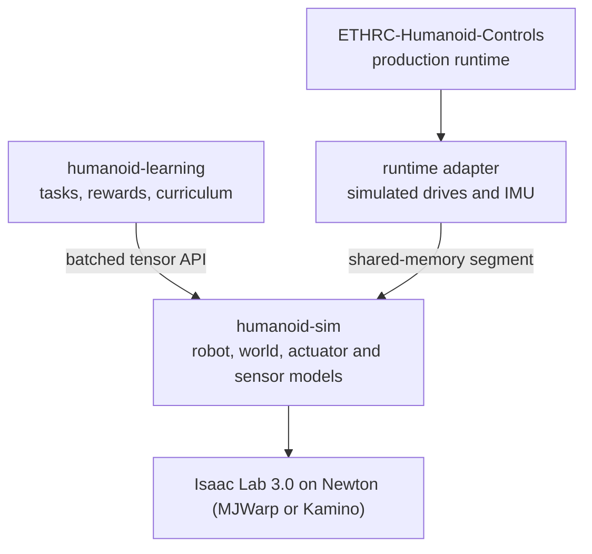
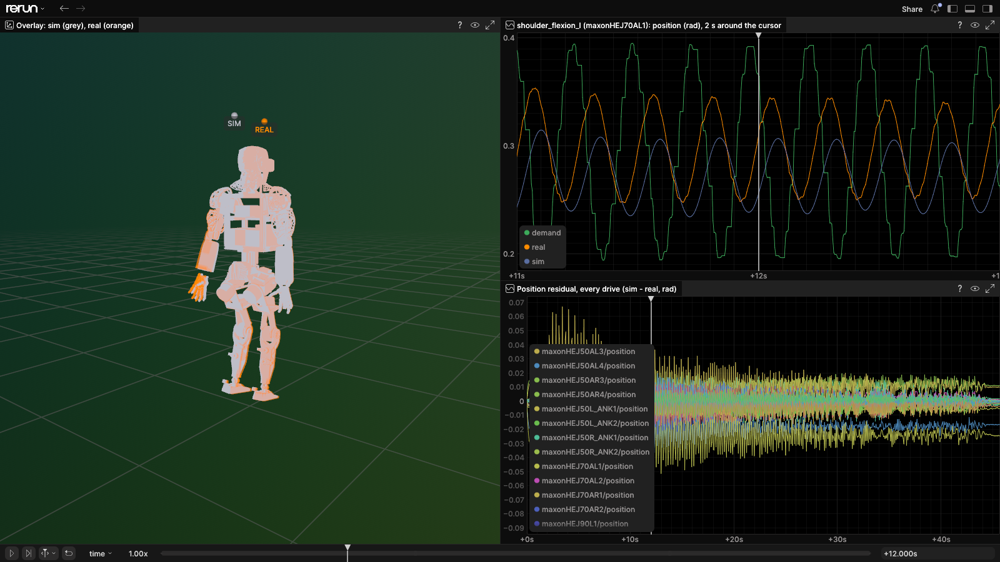
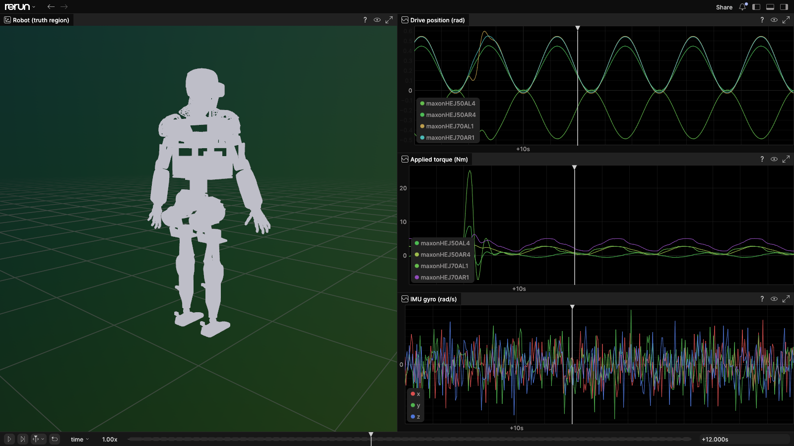

<h1 align="center">humanoid-sim</h1>

<p align="center">
  Humanoids from the drives down: the ETHRC humanoid's 22 drives and ankle linkage, the Unitree G1's 29 motors, and their bodies,<br/> simulated on Isaac Lab 3.0 and Newton, for training, for Controls and for checking against the robot.
</p>

<p align="center">
  
  
  
  
  
</p>


The sim stops where Controls starts. It takes what the robot's host sends each drive, a control law with its targets and gains in SI units, and returns what each drive and the IMU report back, with the drives' own control law, torque limits, latency, encoder resolution and IMU burst timing in between. Robot facts come from the `humanoid-urdf` description that Controls pins, so the sim and the controller always describe the same robot, and any robot in it runs with `--robot` ([docs/robot-model.md](docs/robot-model.md#robots)).

<table>
  <tr>
    <th width="33%">Train</th>
    <th width="33%">Run with Controls</th>
    <th width="33%">Check against the robot</th>
  </tr>
  <tr>
    <td>Thousands of robots per GPU inside an Isaac Lab task, with randomized friction, masses, latency, gains and sensor errors. <b>4096 robots at about 1,200 simulated seconds per second</b> on one L4.</td>
    <td>One robot in real time behind a shared-memory segment that Controls' plant host attaches to, with commands for resets, supports, pushes and faults. <b>2.7x real time</b> on an L4.</td>
    <td>Replay captures from the real robot drive by drive and score the sim against what the drives measured; fit the command delay and passive joint parameters from batched replays.</td>
  </tr>
  <tr>
    <td><a href="docs/training.md">docs/training.md</a></td>
    <td><a href="docs/runtime.md">docs/runtime.md</a></td>
    <td><a href="docs/replay-and-sysid.md">docs/replay-and-sysid.md</a></td>
  </tr>
</table>

## Where it fits



Policies are trained in humanoid-learning against the same drive and sensor models that Controls runs against in real time. [docs/overview.md](docs/overview.md#where-it-sits-among-the-repos) says which repo owns what.

## See it

<table>
  <tr>
    <td width="50%"></td>
    <td width="50%"></td>
  </tr>
  <tr>
    <td>A replay of a whole-body capture. Grey is the sim, orange the real robot; the plot shows one drive's demand, the real drive and the simulated drive over two seconds.</td>
    <td><code>view-runtime</code> watching a session while a client waves the arms and pushes the left forearm.</td>
  </tr>
</table>

Every viewer writes [Rerun](https://rerun.io) recordings; [docs/visualization.md](docs/visualization.md) shows them all.

## Quick start

```bash
git clone --recursive https://github.com/ETHRoboticsClub/humanoid-sim.git && cd humanoid-sim
uv sync --extra dev --extra newton --extra viz
uv run pytest -m "not physics and not data"          # contract tests, no Isaac Lab needed

docker build -f docker/Dockerfile -t humanoid-sim:dev .  # Isaac Lab 3.0 image (amd64 and arm64)
alias hsim='docker run --rm -v "$PWD":/workspace/humanoid-sim -w /workspace/humanoid-sim humanoid-sim:dev'
hsim build-asset                                     # the robot as USD, under outputs/assets/
hsim pytest -m physics                               # physics tests on Warp's CPU device
```

Physics runs on CUDA; Warp's CPU device runs the same code for tests and small experiments. For a GPU, the SkyPilot tasks in `sky/` set up a node with Isaac Lab and run the end-to-end check, benchmarks and replays. [docs/getting-started.md](docs/getting-started.md) walks through all of it.

## Commands

| Command | What it does |
|---|---|
| `humanoid-sim build-asset [--base-joints]` | Builds the robot USD from the description and profile |
| `humanoid-sim serve --segment PATH [--support suspended\|free] [--persist]` | One robot in real time behind the runtime segment |
| `humanoid-sim view-runtime PATH [--save x.rrd]` | Watches a running session in Rerun, read-only |
| `humanoid-sim replay <exc-dir> [--base yaw\|orientation\|fixed]` | Replays a capture drive by drive and scores it |
| `humanoid-sim view-replay <replay-dir> --save x.rrd` | The replay in Rerun: sim, real robot ghost, every drive signal |
| `humanoid-sim fit-delay <exc-dir>...` | Finds when recorded demands take effect, by batched replay |
| `humanoid-sim fit-passive <exc-dir>... --num-envs N` | Fits upper-body passive joint parameters to captures |
| `humanoid-sim bench [--train\|--runtime] --num-envs N` | Measures throughput or the runtime's step time |

Two runnable examples sit in `examples/`: `runtime_client.py` (a complete runtime client in NumPy) and `train_scene.py` (a training scene with terrain, randomization, pushes and a Rerun recording).

Every command that steps physics runs the profile's Newton solver, MJWarp. `humanoid-sim --solver kamino <command>`, or `robot_sim_cfg(solver="kamino")` in training, runs Kamino instead; it is beta in Newton and not yet checked against the captures.

## Training with it

The plant is an Isaac Lab action term. A task turns its policy's actions into drive demands; the plant applies them as the real drives would and exposes what the robot measures alongside the true state.

```python
from humanoid_sim.train import TrainPlantCfg
from humanoid_sim.train.isaaclab import PlantAction, PlantActionCfg
from humanoid_sim.train.scene import robot_scene_cfg, robot_sim_cfg
from humanoid_sim.world.terrain import rough_terrain_cfg

class Drives(PlantAction):
    def demands(self, actions):  # -> DriveDemand [envs, drives] and the time [envs] (ns) it leaves the host
        ...

cfg.scene = robot_scene_cfg(4096, usd, terrain=rough_terrain_cfg(friction=0.0))  # spawns in the home pose
cfg.sim = robot_sim_cfg(device="cuda:0")
cfg.decimation = 5  # 4 ms physics, 20 ms policy period
cfg.actions.drives = PlantActionCfg(class_type=Drives, action_dim=22, plant=TrainPlantCfg(randomization=[
    {"param": "latency", "dist": "uniform", "range": [0.010, 0.020], "op": "set", "per_target": False},
    {"param": "friction", "dist": "uniform", "range": [0.3, 1.0], "op": "set"},
]))
# In observation and reward terms: plant = env.action_manager.get_term("drives").plant
#   plant.measured()  what the robot reports: drive positions in rad quantized to encoder counts,
#                     torques quantized to mNm, their history, and the IMU samples received so far
#   plant.truth()     joint state, base pose and twist, contact forces
```

Robots spawn in the CAD's home pose: legs straight, both soles flat on the ground. `pose="standing"` uses the standing pose captured on the robot instead, whose soles are pitched by 10 and 17 degrees under an upright base. [docs/training.md](docs/training.md) has the full API.

## How it is built

```
src/humanoid_sim/
  model/           description -> prepared URDF -> USD asset; host kinematics; named poses; mirror map
  timing/          when each demand reaches its drive
  devices/         drive law, torque-speed envelope, faults
  transmissions/   drive frame <-> joint frame, the ankle linkage
  core.py          the plant: batched over [envs, drives], shared by every front end
  sensors/         encoders and IMU delivery
  physics/         the Isaac Lab articulation on MJWarp and its solver joint properties
  randomization/   parameter specs and draws
  world/           terrain, pushes, gantry
  train/           front end: Train-Time API (Isaac Lab scene and action term)
  runtime/         front end: real-time host, the segment ABI, view-runtime
  replay/, sysid/  front end: captures, replays, fits
  signals/         Rerun logging
third_party/       humanoid-urdf (robot facts) and ankle_kinematics, at the commits Controls pins
profiles/          modeling choices that are not robot facts
```

The rules the code follows (no ROS, physics only through Isaac Lab on MJWarp, integer nanoseconds, no robot constants typed into the repo, measured and true quantities kept apart) are in [AGENTS.md](AGENTS.md).

## Documentation

[docs/README.md](docs/README.md) indexes every page by role: hardware, training, Controls, testing. Good first reads are [docs/overview.md](docs/overview.md) and [docs/glossary.md](docs/glossary.md).

## License

Apache 2.0, see [LICENSE](LICENSE).
