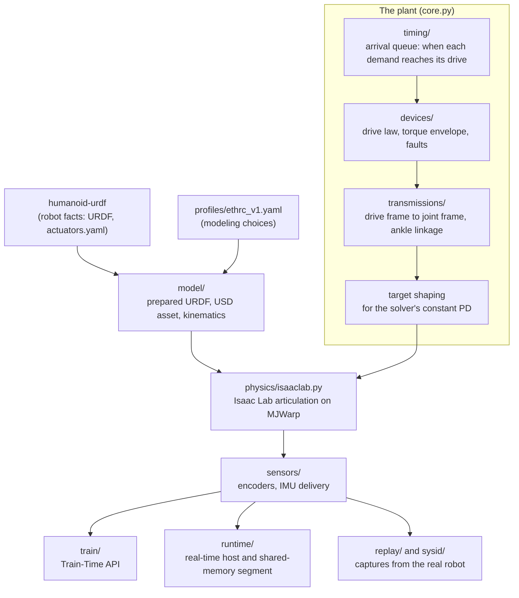

# How humanoid-sim fits together

humanoid-sim simulates the ETHRC humanoid from the EtherCAT drives down: the 22 drives, the ankle linkage and
the body, with physics on Isaac Lab 3.0 and Newton's MJWarp solver. Everything above the drives (the controller,
the policy, the IMU filter, safety logic) belongs to Controls and is not part of this repo. The sim takes what
the master would send each drive and returns what each drive and the IMU would report.

The same plant code serves three uses:

| Use | Who uses it | How many robots | Entry point |
|---|---|---|---|
| Training | humanoid-learning, any Isaac Lab task | Thousands in parallel on one GPU | `humanoid_sim.train` (the Train-Time API) |
| Real-time runtime | Controls' plant host, tests, demos | One, in real time | `humanoid-sim serve` |
| Replay and system identification | Anyone checking the sim against the real robot | One per capture, or many for fits | `humanoid-sim replay`, `fit-delay`, `fit-passive` |

## The layers

1. Robot facts come from the `third_party/humanoid-urdf` submodule: the URDF, and `actuators.yaml` with the
   drive inventory, signs, standing offsets, limits, gains and ankle geometry. No robot constant is typed into
   this repo. [robot-model.md](robot-model.md) explains the files and how the USD asset is built from them.
2. Modeling choices live in `profiles/ethrc_v1.yaml`: physics period (4 ms), solver settings, contact
   excludes, IMU delivery timing. Each Controls-derived value names its source.
3. The plant (`PlantCore` in `src/humanoid_sim/core.py`) is batched torch code over `[envs, drives]`. Per
   physics step it takes the drive demands that have arrived, evaluates each drive's control law and torque
   limits, maps drive quantities to joint quantities through the transmissions (most joints have their own drive;
   at each ankle two crank drives move the pitch and roll hinges together through a linkage), and writes a
   position target for the solver.
   [drives.md](drives.md) covers this in detail.
4. Physics is an Isaac Lab articulation stepped by MJWarp, on CUDA. Warp's CPU device runs the same code for
   tests, slowly.
5. Sensors turn the physical state into what the robot reports: positions quantized to encoder counts,
   torques to mNm, and IMU samples delivered in bursts with noise. See [sensors.md](sensors.md).

## Three front ends

### Training

A manager-based Isaac Lab environment adds the plant as its action term (`PlantAction`). The
task's policy produces drive demands; the plant applies them with randomized latency, friction, gains, masses
and sensor errors, and exposes what the drives measured, what the IMU delivered and the true state for rewards.
[training.md](training.md) shows how to build a task, [world.md](world.md) the terrain, pushes and gantry.

### Runtime

`humanoid-sim serve` runs one robot in real time behind a shared-memory file, the runtime
segment. A client (Controls' plant host, or `examples/runtime_client.py`) writes one demand record per bus cycle
and reads drive feedback and IMU samples back. A mailbox carries commands such as reset, pause, support changes,
pushes and faults. [runtime.md](runtime.md) describes the segment and its protocol;
[controls-integration.md](controls-integration.md) shows how Controls drives it.

### Replay

Excitation captures recorded on the real robot (`datasets/humanoid-v1/exc-*`) are replayed drive by
drive: each simulated drive gets the demand the real drive got, and the sim's positions, velocities and torques
are scored against what the real drives measured. `fit-delay` and `fit-passive` use batched replays to fit the
command delay and passive joint parameters. See [replay-and-sysid.md](replay-and-sysid.md).

## What is measured, what is true

The plant keeps three kinds of quantities apart, and every API names which one it returns:

| Kind | Meaning | Example |
|---|---|---|
| Demanded | What the master asked for | `demanded_torque_nm`: the drive law's output before limits |
| Measured | What a sensor on the robot reports | `plant.measured()`: encoder positions, the IMU samples received so far |
| True | The physical state in the sim, which no sensor on the robot sees | `plant.truth()`: joint state, base pose, contact forces |

A policy should only observe measured quantities; rewards and tests may use the truth.

## Where to go next

| You want to | Read |
|---|---|
| Install, build the asset, run something | [getting-started.md](getting-started.md) |
| Understand a term | [glossary.md](glossary.md) |
| See the sim in Rerun | [visualization.md](visualization.md) |
| Change a robot fact or check the model | [robot-model.md](robot-model.md) |
| Run tests or use a GPU | [testing-and-gpu.md](testing-and-gpu.md) |
| Know how fast it runs | [benchmarks.md](benchmarks.md) |
