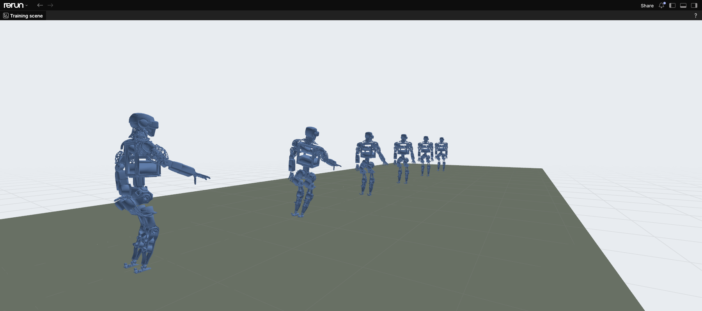
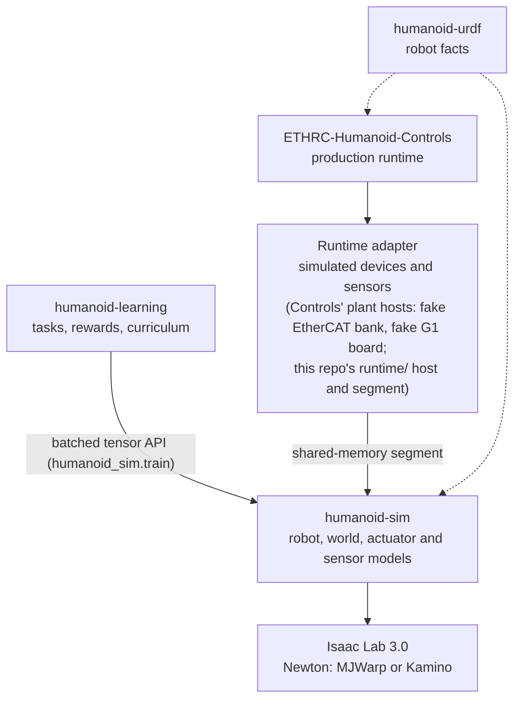
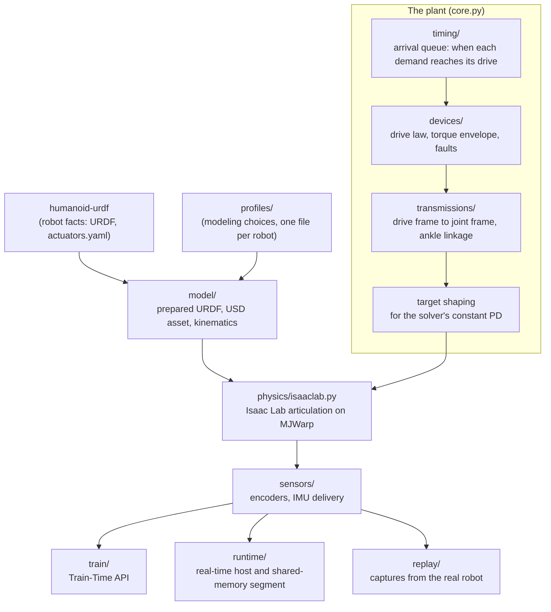

# How humanoid-sim fits together

humanoid-sim simulates humanoids from the drives down, with physics on Isaac Lab 3.0 and Newton (MJWarp or Kamino): the ETHRC humanoid's 22 EtherCAT drives, ankle linkage and body, and any other robot in humanoid-urdf, such as the Unitree G1 ([robot-model.md](robot-model.md#robots)). Everything above the drives (the controller, the policy, the IMU filter, safety logic) belongs to Controls and is not part of this repo. The sim takes what the robot's host would send each drive, as a vendor-neutral SI drive demand, and returns what each drive and the IMU would report.

The same plant code serves three uses:

| Use | Who uses it | How many robots | Entry point |
|---|---|---|---|
| Training | humanoid-learning, any Isaac Lab task | Thousands in parallel on one GPU | `humanoid_sim.train` (the Train-Time API) |
| Real-time runtime | Controls' plant host, tests, demos | One, in real time | `humanoid-sim serve` |
| Replay and system identification | Anyone checking the sim against the real robot | One per capture, or many for fits | `humanoid-sim replay`, `fit-delay`, `fit-passive` |

## Where it sits among the repos

Each repo owns one layer:

- humanoid-learning (`ETHRoboticsClub/humanoid-learning`, with this repo as a submodule) owns tasks, observations, rewards, terminations, terrain generators, curricula, policies and every evaluation of a policy. humanoid-sim offers the mechanisms and the knobs a task turns, such as a heightfield terrain built from the tiles and grid the task gives (`heightfield_terrain_cfg`) and a randomization level (`Randomizer.set_level`), but never chooses them or decides when to turn them. The example environments in `examples/` and [training.md](training.md) only show how a task uses the API.
- humanoid-sim owns the models: the robot (`model/`), the world (`world/`), the actuators (`timing/`, `devices/`, `transmissions/`), the sensors (`sensors/`), and the randomization of their parameters, whose ranges the task chooses. Training reaches them through the Train-Time API, batched torch tensors over `[envs, ...]`.
- Controls owns the production runtime. It drives the simulated robot the way it drives the real one: Controls' plant host and its device peer (the fake EtherCAT bank for the ETHRC V1, the fake motor board for the G1) present simulated drives and an IMU to the rest of Controls, convert each device command into an SI drive demand, and exchange demands and feedback with this repo's runtime host (`runtime/`) through a shared-memory segment. Nothing here imports Controls; Controls copies the segment's ABI (`runtime/abi/plant_abi.py` and `plant_abi.h`).
- Physics runs on Isaac Lab 3.0 with a Newton solver, MJWarp by default or Kamino (beta, `--solver kamino`), without Isaac Sim's Kit app or PhysX. `physics/` is the only place that talks to it. The cameras and lidars are the exception: Kit's RTX renderer draws them over the Newton stage, in an image of their own ([rtx-sensors.md](rtx-sensors.md)).
- humanoid-urdf holds the robot facts both sides read, pinned at the same commit by Controls and by this repo.

Between humanoid-sim and humanoid-learning the line is mechanism against choice: humanoid-sim makes something possible and models it faithfully, humanoid-learning decides what to use, how much and when, and judges the policy.

| Concern | humanoid-sim: the mechanism | humanoid-learning: the choice |
|---|---|---|
| Terrain | `heightfield_terrain_cfg`: a terrain the physics can collide with, from the tiles and grid the caller gives | Terrain generators: tile mixes, sizes and difficulty, and the curriculum that moves envs between rows |
| Disturbances | `ForcePush`, a push process with the caller's ranges; joint torques; the runtime's `APPLY_DISTURBANCE` | Which pushes a task trains and is tested against, and their schedule |
| Randomization | Models of the randomized parameters, their distributions as specs, a level knob | Which parameters, their ranges, and when the level moves |
| Sensors | Sensor models and their knobs (the IMU's noise and delivery timing; cameras, lighting and LIDAR are not modeled yet, and come as knobs here when they are: a light's intensity, a sensor switched off) | Which sensors a policy reads, and ablations over them |
| Evaluation | Checks of the sim itself: replays and system identification against robot captures, physics and model tests, benchmarks | Every evaluation of a policy: scenarios, metrics, robustness sweeps (terrain, pushes, latency, lighting) and sensor ablations (the LIDAR removed, vision only) |

Inside humanoid-sim, dependencies point down. The front ends (`train/`, `runtime/`, `replay/`) use the plant and the models but not each other, and the models never import a front end. The one exception is the description digest, which the segment ABI defines so that Controls can compute it from its own checkout.

## The layers

1. Robot facts come from the `third_party/humanoid-urdf` submodule: the URDF (`URDF_6.urdf`), `actuators.yaml` with the drive inventory, signs, standing offsets, limits, gains and ankle geometry, and the home pose the robot spawns in. No robot constant is typed into this repo. [robot-model.md](robot-model.md) explains the files and how the USD asset is built from them.
2. Modeling choices live in `profiles/<robot>.yaml` over `profiles/defaults.yaml`: physics period (4 ms), solver settings, contact excludes, IMU delivery timing, the home pose. Each Controls-derived value names its source.
3. The plant (`PlantCore` in `src/humanoid_sim/core.py`) is batched torch code over `[envs, drives]`. Per physics step it takes the drive demands that have arrived, evaluates each drive's control law and torque limits, maps drive quantities to joint quantities through the transmissions (most joints have their own drive; at each ankle two crank drives move the pitch and roll hinges together through a linkage), and writes a position target for the solver. [drives.md](drives.md) covers this in detail.
4. Physics is an Isaac Lab articulation stepped by a Newton solver (MJWarp, or Kamino when selected), on CUDA. Warp's CPU device runs the same code for tests, slowly.
5. Sensors turn the physical state into what the robot reports: positions quantized to encoder counts, torques to mNm, and IMU samples with noise, delivered as the rig's IMU delivers them. See [sensors.md](sensors.md).

## Three front ends

### Training

A manager-based Isaac Lab environment adds the plant as its action term (`PlantAction`). The task's policy produces drive demands; the plant applies them with randomized latency, friction, gains, masses and sensor errors, and exposes what the drives measured, what the IMU delivered and the true state for rewards. [training.md](training.md) shows how to build a task, [world.md](world.md) the terrain, pushes and gantry.

### Runtime

`humanoid-sim serve` runs one robot in real time behind a shared-memory file, the runtime segment. A client (Controls' plant host, or `examples/runtime_client.py`) writes one demand record per bus cycle and reads drive feedback and IMU samples back. A mailbox carries commands such as reset, pause, support changes, pushes and faults. [runtime.md](runtime.md) describes the segment and its protocol; [controls-integration.md](controls-integration.md) shows how Controls drives it.

### Replay

Excitation captures recorded on the real robot (`datasets/humanoid-v1/exc-*`) are replayed drive by drive: each simulated drive gets the demand the real drive got, and the sim's positions, velocities and torques are scored against what the real drives measured. `fit-delay` and `fit-passive` use batched replays to fit the command delay and passive joint parameters. See [replay-and-sysid.md](replay-and-sysid.md).

## What is measured, what is true

The plant keeps three kinds of quantities apart, and every API names which one it returns:

| Kind | Meaning | Example |
|---|---|---|
| Demanded | What the master asked for | `demanded_torque_nm`: the drive law's output before limits |
| Measured | What a sensor on the robot reports | `plant.measured()`: encoder positions, the IMU samples received so far |
| True | The physical state in the sim, which no sensor on the robot sees | `plant.truth()`: joint state, base pose, contact forces |

A policy should only observe measured quantities; rewards and tests may use the truth.

## Where to go next

| You want to | Read |
|---|---|
| Install, build the asset, run something | [getting-started.md](getting-started.md) |
| Understand a term | [glossary.md](glossary.md) |
| See the sim in Rerun | [visualization.md](visualization.md) |
| Change a robot fact or check the model | [robot-model.md](robot-model.md) |
| Run tests or use a GPU | [testing-and-gpu.md](testing-and-gpu.md) |
| Know how fast it runs | [benchmarks.md](benchmarks.md) |
