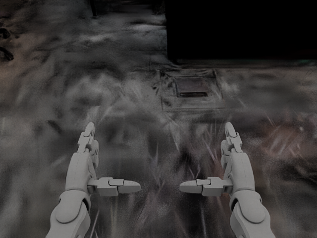
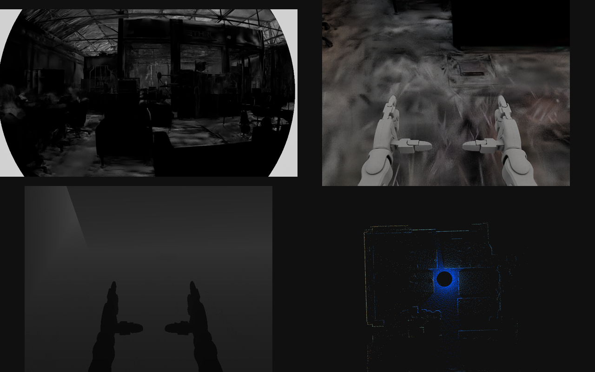

# Cameras and lidar (RTX)

A robot's cameras and lidars are rendered by Isaac Sim's RTX renderer (Kit) while Newton runs the physics, and published the way Controls reads them on the robot: camera frames into Controls' simulated camera feed, the G1's Mid-360 as Unitree's lidar service puts it on DDS. This needs the Isaac Sim image (`docker/Dockerfile.kit`) on an RTX GPU (L40S, A10G or L4). Training and the runtime never start Kit; the plant simulates the IMU only ([sensors.md](sensors.md)).



## What is simulated

The sensors are the robot's rig ([sensors.md](sensors.md#sensor-models-and-the-rig)): every lidar, and every camera whose class places and names the kind of each stream and whose instance calibrates each stream (`Camera.rtx_ready`). The V1's rig has its OAK-D-W (`camera0`, partly modeled: [sensors.md](sensors.md)), the G1's the Mid-360. The `g1-cameras` extra rig (`sensors/rigs.py`) adds the cameras the lab G1 is reported to carry, which its rig does not declare yet: a ZED Mini on the helmet mount (`camera0_camera`) with the lab unit's factory calibration, and a RealSense D435i at Unitree's `d435_link` with the datasheet's fields of view.

| Instance | Model | Streams, as Controls' backend publishes them | Lens or pattern |
|---|---|---|---|
| `zed` (`g1-cameras`) | `ZedMini` | `left`, `right`: grey (mono8), 1280 x 720, 30 Hz, a stereo pair | OpenCV fisheye, the unit's factory calibration; the right eye at the calibration's baseline |
| `d435` (`g1-cameras-d435`) | `RealSenseD435i` | `rgb` (bgr8), `mono_left`, `mono_right` (mono8, stereo pair), `depth` (16UC1 mm, 0.28 to 10 m), 640 x 480, 30 Hz | Pinholes with the datasheet's fields of view (colour 69 deg, infrared 87 x 58 deg) |
| `mid360` (G1 rig) | `LivoxMid360` | 20,000 rays per 100 ms sweep, each with its firing time | -7 to +52 deg over 360 deg, 0.1 to 70 m, 2 cm and 0.15 deg noise (1 sigma) |

Each sensor sits at its rig frame, composed through the URDF's fixed joints onto the body the physics keeps (`geometry.Mount`), and moves with that body: the renderer copies Newton's body poses into Fabric before every render.



### Cameras

`sensors/geometry.py` builds each stream from the camera instance (`camera_spec`); `sensors/rtx.py` puts an Isaac Lab camera for it on the body (`camera_entities`), with the stream's OpenCV pinhole (rational or not) or fisheye model, which RTX renders natively. The V1's OAK-D-W raw streams (rgb and the mono pair) have the rational polynomial lenses of the unit's camera_info; its depth is rectified, a plain pinhole. Each stream sits where the unit's calibration places it and looks along its own optical axis (`stream_rotations_xyzw`): the V1's depth view is turned 0.38° from mono_left, as Controls' `/tf_static` gives it. Grey streams are the BT.601 luma of the colour render; depth is the distance along the optical axis, written as millimetres within the model's range (0 outside it).

### Stereo depth errors

By default the depth is exact. With `depth_noise` (`SessionCfg.depth_noise`, `--depth-noise` on `examples/rtx_sensors.py` and `render-runtime`) each stereo camera's depth is what its matcher would report (`sensors/stereo_depth.py`), from the figures of its model (`sensors/models.py`):

| Error | Model | D435i | OAK-D-W |
|---|---|---|---|
| Noise | Gaussian on the disparity `d = f b / z`, so the depth error grows with the square of the range: `σ_z ≈ z² σ_d / (f b)` (the D400 datasheet's RMS error formula). With `depth_noise_texture_exponent` `a` it grows on plain surfaces: `σ_d · t^-a` at a reference-image texture of `t` grey levels (7 x 7 patch spread), `t` held within `depth_noise_texture_range` | `σ_d` 0.08 px everywhere: about 2 cm at 2 m, 12 cm at 5 m (modeled) | `0.4 · t^-0.2` px, `t` within 0.25–48: 0.53 px on the plainest surfaces, 0.18 px at 48 grey levels (measured) |
| Spread | The noise blurred by a Gaussian of `depth_noise_blur_px` pixels and scaled back to `σ_d` per pixel, so neighbouring pixels err together, as a matcher comparing patches does | none | 3 px (measured) |
| Steps | The noisy disparity rounded to `depth_disparity_step_px`, so the depth takes only the values `f b / k` | none: sub-pixel, taken as continuous | whole pixels (measured; sub-pixel is off): 1.93 or 2.12 m near 2 m, 4.27 or 5.34 m near 5 m |
| Scale | The disparity turned back into depth with the unit's `depth_focal_px` (the rig's camera instance) instead of the depth stream's own focal length, so every depth is off by their ratio | none | the V1's unit: 283.60 px (mono_left's fx) against the stream's 282.19, 0.5 % farther (measured) |
| Occlusion | No depth where the second imager cannot see: a band beside each foreground edge (`d_near − d_far` pixels wide, on the side away from the second imager) and the image border on that side. The matcher's left-right check finds the band: with a threshold `depth_lr_check_px`, a band beside a step of less than that many pixels of disparity keeps its own surface's depth | every occluded pixel | left-right check 10 px (read off the unit; modeled as pixels of disparity): a box at 1.5 m before a wall at 3 m (a 7 px step) keeps its band, at 1 m (14 px) loses it |
| No texture | No depth where the reference imager's 7 x 7 patch spreads less than `depth_min_texture` grey levels (the reference image resampled onto the depth stream's lens, as the matcher sees it rectified; the texture of the noise reads it the same way) | 2 grey levels (modeled; Controls turns its IR projector off) | none (measured: plain surfaces keep their depth, noisier) |
| Median | The rounded disparity filtered by a median over `depth_median_px` square, pixels without depth taken as 0: fills holes and closes bands narrower than about half the window, removes islands of depth that small | none | 5 x 5 (Controls' preset) |

The OAK-D-W's figures were measured on the V1's unit with the matcher as Controls configures it (`HIGH_DENSITY`, sub-pixel off), from 60 s of a static lab scene: every reported depth is the device's `f b` over a whole number of pixels. The noise, its texture exponent and its blur are the values with which the whole chain (noise, rounding, 5 x 5 median), run on the recorded scene, flickers like the recording: each pixel's flicker over time per texture (from 0.54 px on the plainest surfaces to 0.04 px on the most textured), and how much neighbours flicker together (0.74, 0.57 and 0.36 at 1, 2 and 4 px). Turning sub-pixel on in Controls would make the step 1/8 px. The D435i's are modeled until a unit is measured. The errors are drawn from the session's `seed`. Pixels without depth are 0 in the published 16UC1 image, as the cameras report them.

Two Isaac Lab 3.0 behaviours are handled in `sensors/rtx.py`:

- A camera without a colour output (a depth stream) turns colour rendering off for the whole app (`/rtx/sdg/force/disableColorRender`), and every colour camera then renders black. `KitRender` turns it back on before each render.
- RTX's OpenCV lens models centre pixel (u, v) at (u + 0.5, v + 0.5), OpenCV's calibration at (u, v). The principal point given to RTX is moved by half a pixel (`RTX_PIXEL_CENTRE_PX`), so the images match the calibration Controls publishes.

### Lidar

`sensors/lidar.py` makes the lidar an RTX solid-state lidar (Isaac Sim's `OmniLidar`) on its body. Its rays are the model's scan pattern (`geometry.scan_pattern`): the Mid-360's rosette approximated by a low-discrepancy sequence over its field, at its 200,000 points per second, with no direction repeated from one sweep to the next. RTX fires one tick per sweep, every ray of the sweep an emitter firing at its time in the sweep, and switches to the next of ten emitter states each sweep; the pattern repeats every ten sweeps (one second).

RTX reports the rays each render fired; `RtxLidar.read` assembles them into sweeps, every ray in firing order with its time after the sweep's start, a point in the sensor frame and whether it returned. A sweep's start is a plant time: Kit's timeline is held at the plant time of each render (`KitRender`), and the sensor's clock runs with it.

Every ray that meets a surface within range returns. The rooms' surfaces carry no lidar reflectance (RTX non-visual materials), so the reach that depends on reflectivity (the Mid-360's 70 m is at 80 %) and the intensities are not modeled; every return has intensity 100.

## Outputs

| Output | What | Where |
|---|---|---|
| `--feeds DIR` | Controls' simulated camera feed (`ethrc-camera-sim-feed/v1`): per camera `DIR/sim-<instance>/descriptor.json` and a ring per stream, stamped on the realtime clock at the frame's plant time | `sensors/feeds.py` |
| `--lidar-domain N` | The Mid-360 as Unitree's lidar service publishes it: DDS topic `rt/utlidar/cloud_livox_mid360`, ROS 2's `sensor_msgs/PointCloud2` (x, y, z, intensity float32, ring uint16, time float32 ns; 22 bytes a point), frame `livox_frame`, best effort, keep last 5, stamped at the sweep's start; rays that did not return are zero points | `sensors/unitree_lidar.py` (CycloneDDS, no ROS) |
| `--rrd FILE` | A Rerun recording: the robot, the room, every stream (JPEG) and every sweep | `signals/scene.py` |
| `--images DIR` | Each stream's first and last frame, and each lidar's last sweep from above (PNG) | |
| `--summary FILE` | Timings and rates (JSON) | |

Controls reads these as on the robot: its camera service with `--backend sim --sim-feed DIR` for the cameras, and `--unitree-lidar --unitree-domain N` for the lidar, which it republishes on its sensor contract (`sensors/mid360/points`, frame `mid360_link`).

## Running it

On a GPU node set up by `sky/rtx.sky.yaml` (both images: the first build takes about 40 minutes, Kit's first start about 8 more to compile its shaders, which the task keeps):

```bash
sky launch -y -d -c hsim-rtx -i 30 --gpus L40S:1 sky/rtx.sky.yaml
H=/data/hangar   # Controls' ros2_ws/src/sim/ethrc_sim/environments/hangar, mounted by the task
sky exec hsim-rtx --env CMD="humanoid-sim --robot g1_29dof_with_hand_rev_1_0 build-asset && \
  humanoid-sim splat-usd $H/hangar_splat.ply outputs/rtx/hangar_splat.usdc --spawn -4.42 3.48 --half" sky/rtx.sky.yaml
sky exec hsim-rtx --env CMD="python examples/rtx_sensors.py --sensors g1-cameras \
  --scene $H/hangar_proxy.npz --spawn -4.42 3.48 --scan-mesh $H/hangar_visual.obj \
  --splat outputs/rtx/hangar_splat.usdc --seconds 4 \
  --rrd outputs/rtx/g1_hangar_sensors.rrd --images outputs/rtx/frames" sky/rtx.sky.yaml
rsync -avz hsim-rtx:sky_workdir/outputs/rtx/ outputs/rtx/
```

The robot is welded at the spawn point in its home pose, feet just above the floor (a G1 cannot stand on a fixed-gain hold). `--splat-intensity` scales the splat's emission.

### Rendering a recorded run

`render-runtime` draws from the host's latest truth and skips frames when the GPU falls behind, so its rates depend on the machine. For a benchmark that needs the cameras and the lidar at their nominal rates, record the run and render it afterwards in lockstep with plant time:

```bash
humanoid-sim serve --segment /run/hsim/plant --trajectory /data/run1.traj --gantry hangar_gantry.json --scene ... # the live run
humanoid-sim render-trajectory /data/run1.traj --out /data/run1-sensors --sensors g1-cameras \
    --no-cameras                                                    # the lidar pass, no splat; the robot, scene,
humanoid-sim render-trajectory /data/run1.traj --out /data/run1-sensors --sensors g1-cameras \
    --no-lidar --splat outputs/rtx/hangar_splat.usdc                # spawn, scan and crane are the recording's
humanoid-sim export-truth /data/run1.traj --frames mid360_link camera0_camera imu_link --out /data/run1-truth
```

`render-trajectory` poses the robot at each render time (the recording interpolated to it), renders every camera period (33.3 ms at 30 Hz) and lets the lidar complete its sweeps (10 Hz), however long the GPU takes. Every stream is rendered at the render period, the fastest stream's; a slower stream gets the first render at or after each of its periods. Each frame is stamped with the plant time it was rendered at, a sweep with the plant time its first ray fired, so stamps, ground truth and the runtime's feedback and IMU samples share one clock. The dataset it writes (`humanoid-sim-sensor-dataset/v1`, `sensors/dataset.py`) holds `manifest.json` (the camera calibrations as the feed descriptor has them, each sensor's mount on its body, nominal rates, counts, and `passes`: each render's sensors and summary, `complete` only if it finished), `cameras/<camera_id>/<stream>/` (8-bit grey, RGB or 16-bit millimetre PNGs and `index.csv`: `seq,stamp_ns,file`) and `lidars/<name>/` (one `.npz` per sweep with `points_m`, `hit`, `time_s`, `start_ns` and the sensor's world pose, and `index.csv`; `start_ns` and `time_s` are the sweep's start and each ray's firing time after it, but `origin_w` and `rotation_w` are the sensor's pose at the render that completed the sweep, about one sweep period after `start_ns`: to place a ray in the world at its firing time, take the sensor's pose at that time from the trajectory). A dataset holds one lidar's sweeps. The IMU is not rendered (the render never steps physics): the live run records it next to the trajectory (`FILE.imu`, [runtime.md](runtime.md#recording-a-run)), on the same plant clock.

### Inputs for sensor-contract replay

For URDF-backed descriptions, the dataset also contains `robot.urdf`,
`kinematics.npz` (plant timestamps, joint positions and joint names) and copies of
recorded IMU side files. The manifest's `replay` block identifies these by SHA-256
and names the base frame; `trajectory_sha256` identifies the source recording.
Trajectory and IMU headers share a unique `recording_id`, so an IMU file from a
different run is refused even when the robot and description match. Record a new run
when this identity is absent.

Kinematics contains no base/world pose. A downstream converter supplies local
mount TF and measured joints to SLAM; the original trajectory is a separate
reference for evaluation. LiDAR NPZs include `intensity`, the same modeled
constant used by the live transport, not a measured reflectance. Replay metadata
for USD-backed descriptions is not supported.

The manifest is marked incomplete before a pass replaces any indexed frames.
A process killed during a rerender cannot leave an older completed pass looking
like a valid dataset. A different trajectory checksum is refused even when the
file name and time range match.

### Two passes: the lidar must not trace the splat

RTX hides the splat from camera rays only (`SPLAT_PRIM`): a lidar ray hits its Gaussians wherever it meets one, low-opacity and large ones included, so a lidar rendered with a splat returns points in mid-air. `render-trajectory` refuses a lidar with `--splat`: the lidar and the cameras are rendered in two runs into one `--out`, the lidar without the splat (`--no-cameras`), the cameras with it (`--no-lidar`). A dataset directory that holds a manifest of the same run (robot, description digest, trajectory, time range) is added to, each pass keeping the other's sensors and counts; a manifest of another run is refused, and a render that fails leaves its pass `complete: false`. Each sensor's manifest `stage` records `splat` (whether it was on the stage for that sensor) and `robot_links_traced`. The recording's scene files must be readable where it is rendered (same paths), or be given with `--scene`.

### The robot occludes its own sensors

The rays also hit the robot's visual meshes: the G1's Mid-360 sits inside the head's shell with the shoulders and arms below it, so the head's ribs and the shoulders block parts of its field. That is what the meshes in the description do; whether the real unit's head has an opening at the lidar, and what Unitree's driver filters, is not known here (the sensor's 0.1 m minimum range is applied, `nearRangeM`). Compare a recorded cloud of the real unit before hiding any link from the lidar.

### What each sensor sees of a scanned room

A scanned room has up to three surfaces: its boxes (`--scene`), its scan's mesh (`--scan-mesh`, added only when a lidar is simulated) and its splat (`--splat`, made by `humanoid-sim splat-usd`, [world.md](world.md)). The physics collides with every box whatever the sensors see. Each sensor sees the most faithful surface it has (`sensors/room_rays.py`, applied by `SensorSession`):

| Surface | Lidar | Cameras with a splat | Cameras without a splat |
|---|---|---|---|
| Splat | no: it must not be on the stage (below) | yes | |
| Scan mesh | yes | no | yes |
| Wall boxes (the file's `wall` flags) | yes | no | yes |
| Furniture boxes | only without a scan mesh | no | only without a scan mesh |
| Ground | yes | no | yes |

The furniture boxes enclose the scanned furniture by up to tens of centimetres and would shadow it; the wall boxes stay for the lidar because the scan has holes at windows and doors, and the walls keep every return inside the room. Without a splat the cameras see what the lidar sees, so the depth stream and the lidar agree. The scan mesh is added only when a lidar is simulated, so without a splat `--no-lidar` changes the cameras' depth: they see every box, the furniture boxes included, and no mesh. A boxes file without `wall` flags does not say which boxes bound the room: every box is then kept as a wall. A box no sensor sees is made invisible; one only the lidar sees, and the scan mesh under a splat, are hidden from camera rays (`primvars:hideForCamera`) and cast no shadows (`primvars:doNotCastShadows`, `rtx.hide_from_cameras`), as is the ground under a splat: RTX dims the splat by the share of the stage's lights that geometry hides from it, whatever their intensity, so stand-ins that cast shadows would darken the room. The summary's `scene.rays` records the outcome.

### Lights

The stage is lit by a white dome light (600 nits, `rtx.DOME_INTENSITY`): the robot and the boxes are lit evenly and cast no shadows; the splat is emissive, and a light never brightens it (`--splat-intensity` scales its emission). `SessionCfg.lights` changes the lighting (`src/humanoid_sim/sensors/lights.py`): a `Lighting` built in code, which is how a task or a low-light preset sets it, or the path of a JSON file with the same fields, which is how a room's owner sets it (`render-runtime --lights PATH`). Both are checked the same way; a file's keys are all optional, though it must give at least one. Without either, the scene is the one above, exactly. The dome is spawned with its intensity and colour temperature; the other lights are authored as UsdLux prims when the session is built.

```python
from humanoid_sim.sensors.lights import Fixture, Lighting, Sun

dusk = Lighting(dome_intensity=40, dome_temperature_k=3200,
                fixtures=[Fixture(position_m=(0.0, 2.0, 7.5), size_m=(0.6, 1.2), intensity=1500)],
                sun=Sun(azimuth_deg=250, elevation_deg=5, intensity=200, temperature_k=2500))
SessionCfg(lights=dusk)
```

| Key | Meaning |
|---|---|
| `dome_intensity` | replaces the dome's intensity (nits); 0 turns the dome off |
| `dome_temperature_k` | dome colour temperature in Kelvin (1000 to 40000; Isaac Lab's `DomeLightCfg.color_temperature`); left out, the dome stays white |
| `fixtures` | extra lights, in the scan's frame (the frame the room's boxes file uses), placed in the world frame by the host's spawn point as the boxes and scan are |
| `sun` | one distant light for outdoor scenes, in the world frame |

Each fixture has a `position_m`, its `intensity` (luminance in nits for an area light), an optional linear RGB `color` (white by default) and an optional `temperature_k` (multiplied with `color`), and exactly one shape. A rectangle (`size_m`, USD `RectLight`) or a disk (`radius_m`, `DiskLight`) faces straight down, like a hangar ceiling panel; a sphere (`sphere_radius_m`, `SphereLight`) radiates in all directions, a point-like bulb.

The sun has `azimuth_deg` (the sun's bearing from +x towards +y), `elevation_deg` (above the horizon, 0 to 90), `intensity` (illuminance in USD distant light units), `angle_deg` (angular diameter, 0.53 by default; a larger angle softens shadows) and optional `color` and `temperature_k`. The light shines from that direction towards the scene. Low-light presets are humanoid-learning's choice of these values.

```json
{"fixtures": [{"position_m": [0.0, 2.0, 7.5], "size_m": [0.6, 1.2], "intensity": 3000, "temperature_k": 4000},
              {"position_m": [3.5, 2.0, 7.5], "radius_m": 0.4, "intensity": 3000},
              {"position_m": [-2.0, 1.0, 2.5], "sphere_radius_m": 0.08, "intensity": 800, "temperature_k": 2700}],
 "dome_intensity": 100,
 "dome_temperature_k": 6500,
 "sun": {"azimuth_deg": 135, "elevation_deg": 40, "intensity": 3000, "angle_deg": 0.53, "temperature_k": 5800}}
```

The summary's `scene.lights` names the file (null without one, or for a `Lighting` given in code), `scene.lighting` records every setting the stage was lit with (null without any), `scene.dome_light_nits` the dome (null without one) and `scene.dome_temperature_k` its colour temperature (null: white).

A Lambertian panel of area `A` and luminance `L` puts out `pi L A`; a grid with one panel per `s` by `s` of floor lights it at about `pi L A / s^2` (lux, with nits for `L`).

## On a running runtime: `render-runtime`

Mixed camera/LiDAR rigs use two independent Kit workers. Both read the same live plant
segment and its clock; neither advances physics. The camera worker loads the Gaussian
scene and writes camera feeds. The LiDAR worker loads the scan geometry without the
Gaussian primitives and owns the LiDAR publisher. Camera-only and LiDAR-only rigs
keep one worker. `--combined` explicitly selects the former shared-render loop for
comparisons. Two workers need additional GPU memory; this does not guarantee nominal
rates. Inspect acquisition age and each worker's measured cadence.

SIGINT/SIGTERM stops both workers. A failed worker stops its sibling and makes the
command fail. `--summary` contains separate worker summaries and exit codes; image
exports belong to the camera worker and a LiDAR Rerun recording uses `.lidar.rrd`.


`humanoid-sim render-runtime <segment>` renders a running `serve`'s robot with the same sensors and outputs (`src/humanoid_sim/runtime/render.py`). It never steps physics and never writes to the segment: each render it takes the latest truth (base pose and joint positions), poses the robot there by forward kinematics (`SensorSession.pose`) and renders at that plant time (`SensorSession.render_at`). It renders as fast as Kit allows, at most once per camera period (the lidar's sweep period without cameras), and a render that falls behind skips to the latest truth; the host keeps real time on its own. Stamps map plant time onto the realtime clock through the host's own mapping (the feedback region's `written_mono_ns` at `sim_time_ns`). The scene is the host's: its boxes and scan from the descriptor when the files are readable here with the same digests, plus `--splat` for the cameras and `--lights` ([Lights](#lights)). It follows a `--persist` host's next session.

```bash
humanoid-sim serve --segment /run/hsim/plant --truth-every 1 --scene $H/hangar_proxy.npz --spawn -4.42 3.48 \
  --scan-mesh $H/hangar_visual.obj --scan-texture $H/hangar_visual.png --scan-floor-texture $H/hangar_floor.png &
humanoid-sim render-runtime /run/hsim/plant --splat outputs/rtx/hangar_splat.usdc \
  --feeds /run/ethrc-camera-feed --lidar-domain 7 --summary outputs/rtx/render.json
```

The summary adds `render_rate_hz`, `lag_ms` (the host's plant time when a render's frames are out, minus the render's plant time) and `host_keeping_up` (the share of renders during which the host kept real time). Controls runs it as `just sim-isaac-rtx`. A heartbeat older than 500 ms or from a different monotonic clock ends rendering for that session, including when plant time is frozen. The renderer waits up to 10 s for a fresh session at the same path and then exits if the host does not return; a normally paused host keeps publishing its heartbeat and remains connected.

Camera stamps and lidar sweep-start stamps use the host's plant-to-monotonic mapping. The mapping advances through rendering and readout, so a slow render delays delivery without moving the recorded capture time. The two eyes of a stereo frame share one exposure stamp.

## Checks

`tests/test_rtx_sensors.py` (marker `rtx`, in the Isaac Sim image on an RTX GPU, in a process of its own: `pytest -m rtx tests/test_rtx_sensors.py`) puts the G1 in a box room with targets and compares what each sensor reports with geometry worked out without the renderer (`tests/rtx_oracles.py`), using the mounts the G1's URDF in humanoid-urdf gives (read when the tests run) and the lens figures:

| Sensor | Check | Agreement on an L40S |
|---|---|---|
| ZED Mini, both eyes | The target's image against the share of each pixel whose rays, cast through the fisheye calibration, meet it | Centroids within 0.3 px, areas within 5 % |
| D435i colour | The same through the datasheet pinhole | Within 0.3 px and 5 % |
| D435i depth | Every pixel against the distance to the room along its ray | Median error under 5 mm, 99th percentile under 1 cm |
| Mid-360 | Every return against where its ray meets the room, the sensor's pose against its mount; sweep starts 100 ms apart, firing times within the sweep, elevations within the band | 99th percentile range error under 1 cm |

The noise is off in these checks (`lidar_noise=False`). `tests/test_sensor_feeds.py` reads the feed back with Controls' own reader and `tests/test_unitree_lidar.py` the cloud with Controls' own decoder (both with `HUMANOID_SIM_CONTROLS` naming a Controls checkout).

## Cost

Measured on an L40S (`examples/rtx_sensors.py --summary`, 10 s in the hangar, the G1 welded, physics every 4 ms):

| What renders | Render, median | Real-time factor | Frames per second, per camera stream | Sweeps per second |
|---|---|---|---|---|
| The six camera streams, the Mid-360, the splat | 108 ms | 0.18 | 5.4 | 1.8 |
| The same, published (feeds and DDS) | 101 ms | 0.18 | 5.3 | 1.8 |
| The six camera streams and the splat | 97 ms | 0.19 | 5.7 | |
| The six camera streams, no splat | 82 ms | 0.22 | 6.6 | |
| The Mid-360 alone, with the scan's mesh | 44 ms a sweep | 0.53 | | 5.1 |

A render serves every sensor due; the cameras render every 33 ms of plant time, the lidar alone every sweep. Each camera stream is a render product of its own, so the cost grows with the number of streams. A physics step takes 4.7 ms (median) with Kit up, publishing a frame or a sweep 0.1 ms (median).

## What is not modeled

- Camera exposure, noise, motion blur and rolling shutter: every frame is a global-shutter render at the frame's plant time, every camera at one fixed exposure: RTX's auto exposure off and its tone mapping set by `rtx.EXPOSURE` (ACES, ISO 100, 1/50 s at f/5: Isaac Sim 6.2's defaults, pinned so a Kit upgrade cannot change how bright a room renders); the summary's `rtx_post` records the values Kit ran with. The D435i's infrared imagers see visible light, without the projector's pattern.
- Stereo depth is exact unless `depth_noise` is on, and then it has the errors above only: no correlation of the noise farther than its blur and the median reach (the OAK-D-W's errors stay correlated past 30 px, more along rows than along columns), no confidence threshold of its own (the texture threshold stands for it), no widening of foreground edges by the matcher's window, no grazing-angle failures or flying pixels at edges, and none of the cameras' post-processing filters other than the median.
- With the ZED Mini's fisheye calibration, RTX leaves the corners of the image, beyond about 46 deg off axis, empty (light grey).
- The Mid-360's real rosette, its reflectivity-dependent reach and intensities. Within one render the lidar sees the scene as it is at that render (Kit's motion BVH is off), so a moving robot's sweep is built from three renders.
- The D435i on the G1 has no `<mount>_camera` link in the description, so Controls places it at a default mount; the ZED Mini mount's pitch is assumed level (the G1 URDF's `camera0_camera`).
