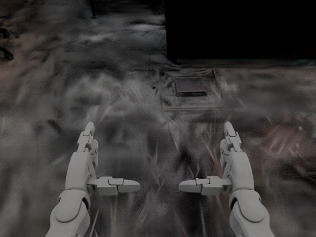
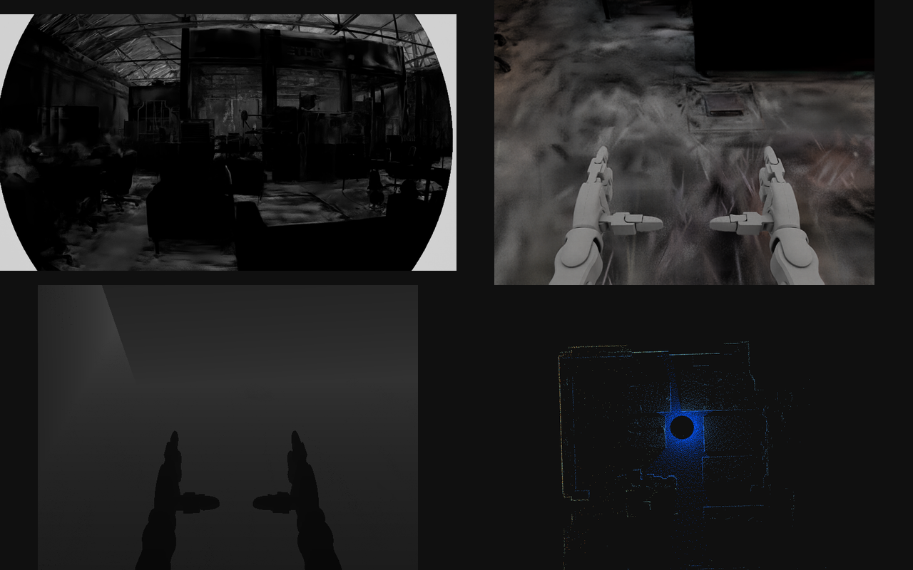

# Cameras and lidar (RTX)

A robot's cameras and lidars are rendered by Isaac Sim's RTX renderer (Kit) while Newton runs the physics, and published the way Controls reads them on the robot: camera frames into Controls' simulated camera feed, the G1's Mid-360 as Unitree's lidar service puts it on DDS. This needs the Isaac Sim image (`docker/Dockerfile.kit`) on an RTX GPU (L40S, A10G or L4). Training and the runtime never start Kit; the plant simulates the IMU only ([sensors.md](sensors.md)).



## What is simulated

The sensors are the robot's rig ([sensors.md](sensors.md#sensor-models-and-the-rig)): every lidar, and every camera whose class places and names the kind of each stream and whose instance calibrates each stream (`Camera.rtx_ready`). The V1's rig has its OAK-D-W (`camera0`, partly modeled: [sensors.md](sensors.md)), the G1's the Mid-360. The `g1-cameras` extra rig (`sensors/rigs.py`) adds the cameras the lab G1 is reported to carry, which its rig does not declare yet: a ZED Mini on the helmet mount (`camera0_camera`) with the lab unit's factory calibration, and a RealSense D435i at Unitree's `d435_link` with the datasheet's fields of view.

| Instance | Model | Streams, as Controls' backend publishes them | Lens or pattern |
|---|---|---|---|
| `zed` (`g1-cameras`) | `ZedMini` | `left`, `right`: grey (mono8), 1280 x 720, 30 Hz, a stereo pair | OpenCV fisheye, the unit's factory calibration; the right eye at the calibration's baseline |
| `d435` (`g1-cameras`) | `RealSenseD435i` | `rgb` (bgr8), `mono_left`, `mono_right` (mono8, stereo pair), `depth` (16UC1 mm, 0.28 to 10 m), 640 x 480, 30 Hz | Pinholes with the datasheet's fields of view (colour 69 deg, infrared 87 x 58 deg) |
| `mid360` (G1 rig) | `LivoxMid360` | 20,000 rays per 100 ms sweep, each with its firing time | -7 to +52 deg over 360 deg, 0.1 to 70 m, 2 cm and 0.15 deg noise (1 sigma) |

Each sensor sits at its rig frame, composed through the URDF's fixed joints onto the body the physics keeps (`geometry.Mount`), and moves with that body: the renderer copies Newton's body poses into Fabric before every render.



### Cameras

`sensors/geometry.py` builds each stream from the camera instance (`camera_spec`); `sensors/rtx.py` puts an Isaac Lab camera for it on the body (`camera_entities`), with the stream's OpenCV pinhole or fisheye model, which RTX renders natively. Grey streams are the BT.601 luma of the colour render; depth is the distance along the optical axis, written as millimetres within the model's range (0 outside it).

Two Isaac Lab 3.0 behaviours are handled in `sensors/rtx.py`:

- A camera without a colour output (a depth stream) turns colour rendering off for the whole app (`/rtx/sdg/force/disableColorRender`), and every colour camera then renders black. `KitRender` turns it back on before each render.
- RTX's OpenCV lens models centre pixel (u, v) at (u + 0.5, v + 0.5), OpenCV's calibration at (u, v). The principal point given to RTX is moved by half a pixel (`RTX_PIXEL_CENTRE_PX`), so the images match the calibration Controls publishes.

### Lidar

`sensors/lidar.py` makes the lidar an RTX solid-state lidar (Isaac Sim's `OmniLidar`) on its body. Its rays are the model's scan pattern (`geometry.scan_pattern`): the Mid-360's rosette approximated by a low-discrepancy sequence over its field, at its 200,000 points per second, with no direction repeated from one sweep to the next. RTX fires one tick per sweep, every ray of the sweep an emitter firing at its time in the sweep, and switches to the next of ten emitter states each sweep; the pattern repeats every ten sweeps (one second).

RTX reports the rays each render fired; `RtxLidar.read` assembles them into sweeps, every ray in firing order with its time after the sweep's start, a point in the sensor frame and whether it returned. A sweep's start is a plant time: Kit's timeline is held at the plant time of each render (`KitRender`), and the sensor's clock runs with it.

Every ray that meets a surface within range returns. The rooms' surfaces carry no lidar reflectance (RTX non-visual materials), so the reach that depends on reflectivity (the Mid-360's 70 m is at 80 %) and the intensities are not modeled; every return has intensity 100.

## Outputs

| Output | What | Where |
|---|---|---|
| `--feeds DIR` | Controls' simulated camera feed (`ethrc-camera-sim-feed/v1`): per camera `DIR/sim-<instance>/descriptor.json` and a ring per stream, stamped on the realtime clock at the frame's plant time | `sensors/feeds.py` |
| `--lidar-domain N` | The Mid-360 as Unitree's lidar service publishes it: DDS topic `rt/utlidar/cloud_livox_mid360`, ROS 2's `sensor_msgs/PointCloud2` (x, y, z, intensity float32, ring uint16, time float32 ns; 22 bytes a point), frame `livox_frame`, best effort, keep last 5, stamped at the sweep's start; rays that did not return are zero points | `sensors/unitree_lidar.py` (CycloneDDS, no ROS) |
| `--rrd FILE` | A Rerun recording: the robot, the room, every stream (JPEG) and every sweep | `signals/scene.py` |
| `--images DIR` | Each stream's first and last frame, and each lidar's last sweep from above (PNG) | |
| `--summary FILE` | Timings and rates (JSON) | |

Controls reads these as on the robot: its camera service with `--backend sim --sim-feed DIR` for the cameras, and `--unitree-lidar --unitree-domain N` for the lidar, which it republishes on its sensor contract (`sensors/mid360/points`, frame `mid360_link`).

## Running it

On a GPU node set up by `sky/rtx.sky.yaml` (both images: the first build takes about 40 minutes, Kit's first start about 8 more to compile its shaders, which the task keeps):

```bash
sky launch -y -d -c hsim-rtx -i 30 --gpus L40S:1 sky/rtx.sky.yaml
H=/data/hangar   # Controls' ros2_ws/src/sim/ethrc_sim/environments/hangar, mounted by the task
sky exec hsim-rtx --env CMD="humanoid-sim --robot g1_29dof_with_hand_rev_1_0 build-asset && \
  humanoid-sim splat-usd $H/hangar_splat.ply outputs/rtx/hangar_splat.usdc --spawn -4.42 3.48 --half" sky/rtx.sky.yaml
sky exec hsim-rtx --env CMD="python examples/rtx_sensors.py --sensors g1-cameras \
  --scene $H/hangar_proxy.npz --spawn -4.42 3.48 --scan-mesh $H/hangar_visual.obj \
  --splat outputs/rtx/hangar_splat.usdc --splat-intensity 3 --seconds 4 \
  --rrd outputs/rtx/g1_hangar_sensors.rrd --images outputs/rtx/frames" sky/rtx.sky.yaml
rsync -avz hsim-rtx:sky_workdir/outputs/rtx/ outputs/rtx/
```

The robot is welded at the spawn point in its home pose, feet just above the floor (a G1 cannot stand on a fixed-gain hold). In a scanned room, the room's boxes collide and the lidar sees them and the scan's mesh (`--scan-mesh`); with its splat (`--splat`, made by `humanoid-sim splat-usd`, [world.md](world.md)) the cameras see the splat, the boxes, the mesh and the ground being hidden from camera rays. RTX shows the splat's baked colours darker than the scan's photographs; `--splat-intensity` scales its emission.

## On a running runtime: `render-runtime`

`humanoid-sim render-runtime <segment>` renders a running `serve`'s robot with the same sensors and outputs (`src/humanoid_sim/runtime/render.py`). It never steps physics and never writes to the segment: each render it takes the latest truth (base pose and joint positions), poses the robot there by forward kinematics (`SensorSession.pose`) and renders at that plant time (`SensorSession.render_at`). It renders as fast as Kit allows, at most once per camera period (the lidar's sweep period without cameras), and a render that falls behind skips to the latest truth; the host keeps real time on its own. Stamps map plant time onto the realtime clock through the host's own mapping (the feedback region's `written_mono_ns` at `sim_time_ns`). The scene is the host's: its boxes and scan from the descriptor when the files are readable here with the same digests, plus `--splat` for the cameras. It follows a `--persist` host's next session.

```bash
humanoid-sim serve --segment /run/hsim/plant --truth-every 1 --scene $H/hangar_proxy.npz --spawn -4.42 3.48 \
  --scan-mesh $H/hangar_visual.obj --scan-texture $H/hangar_visual.png --scan-floor-texture $H/hangar_floor.png &
humanoid-sim render-runtime /run/hsim/plant --splat outputs/rtx/hangar_splat.usdc --splat-intensity 3 \
  --feeds /run/ethrc-camera-feed --lidar-domain 7 --summary outputs/rtx/render.json
```

The summary adds `render_rate_hz`, `lag_ms` (the host's plant time when a render's frames are out, minus the render's plant time) and `host_keeping_up` (the share of renders during which the host kept real time). Controls runs it as `just sim-isaac-rtx`.

## Checks

`tests/test_rtx_sensors.py` (marker `rtx`, in the Isaac Sim image on an RTX GPU, in a process of its own: `pytest -m rtx tests/test_rtx_sensors.py`) puts the G1 in a box room with targets and compares what each sensor reports with geometry worked out without the renderer (`tests/rtx_oracles.py`), using the mounts humanoid-urdf's `PROVENANCE.md` records and the lens figures:

| Sensor | Check | Agreement on an L40S |
|---|---|---|
| ZED Mini, both eyes | The target's image against the share of each pixel whose rays, cast through the fisheye calibration, meet it | Centroids within 0.3 px, areas within 5 % |
| D435i colour | The same through the datasheet pinhole | Within 0.3 px and 5 % |
| D435i depth | Every pixel against the distance to the room along its ray | Median error under 5 mm, 99th percentile under 1 cm |
| Mid-360 | Every return against where its ray meets the room, the sensor's pose against its mount; sweep starts 100 ms apart, firing times within the sweep, elevations within the band | 99th percentile range error under 1 cm |

The noise is off in these checks (`lidar_noise=False`). `tests/test_sensor_feeds.py` reads the feed back with Controls' own reader and `tests/test_unitree_lidar.py` the cloud with Controls' own decoder (both with `HUMANOID_SIM_CONTROLS` naming a Controls checkout).

## Cost

Measured on an L40S (`examples/rtx_sensors.py --summary`, 10 s in the hangar, the G1 welded, physics every 4 ms):

| What renders | Render, median | Real-time factor | Frames per second, per camera stream | Sweeps per second |
|---|---|---|---|---|
| The six camera streams, the Mid-360, the splat | 108 ms | 0.18 | 5.4 | 1.8 |
| The same, published (feeds and DDS) | 101 ms | 0.18 | 5.3 | 1.8 |
| The six camera streams and the splat | 97 ms | 0.19 | 5.7 | |
| The six camera streams, no splat | 82 ms | 0.22 | 6.6 | |
| The Mid-360 alone, with the scan's mesh | 44 ms a sweep | 0.53 | | 5.1 |

A render serves every sensor due; the cameras render every 33 ms of plant time, the lidar alone every sweep. Each camera stream is a render product of its own, so the cost grows with the number of streams. A physics step takes 4.7 ms (median) with Kit up, publishing a frame or a sweep 0.1 ms (median).

## What is not modeled

- Camera exposure, noise, motion blur and rolling shutter: every frame is a global-shutter render at the frame's plant time. The D435i's infrared imagers see visible light, without the projector's pattern; its depth is the exact distance, without stereo matching.
- With the ZED Mini's fisheye calibration, RTX leaves the corners of the image, beyond about 46 deg off axis, empty (light grey).
- The Mid-360's real rosette, its reflectivity-dependent reach and intensities. Within one render the lidar sees the scene as it is at that render (Kit's motion BVH is off), so a moving robot's sweep is built from three renders.
- The D435i on the G1 has no `<mount>_camera` link in the description, so Controls places it at a default mount; the ZED Mini mount's pitch is assumed level (the G1 URDF's `camera0_camera`).
