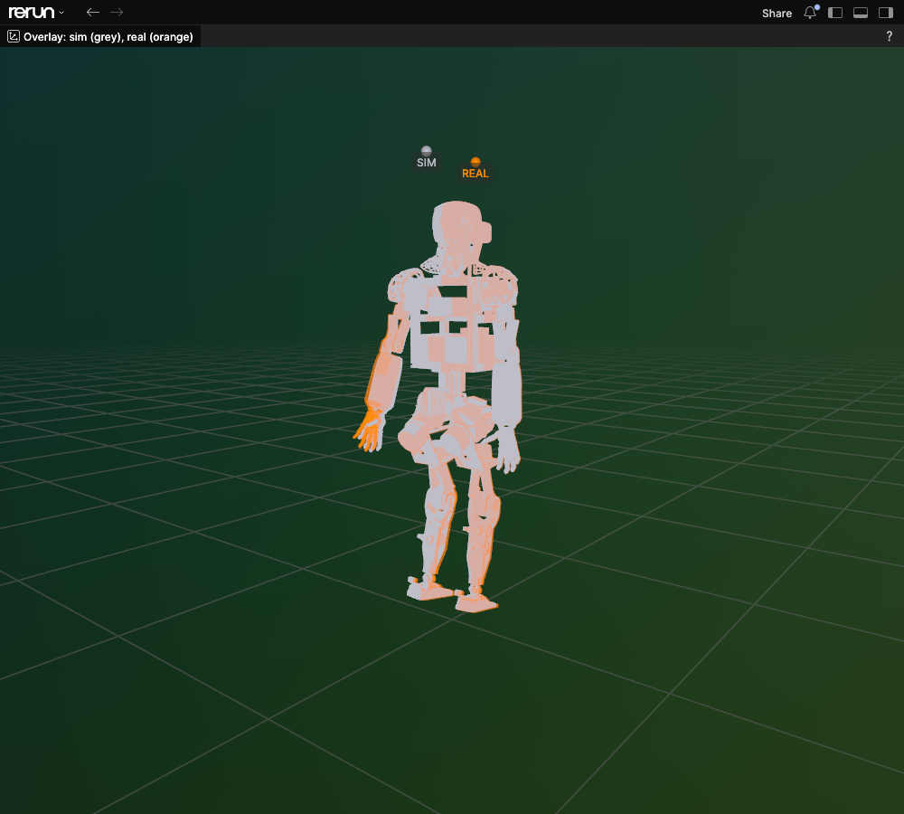
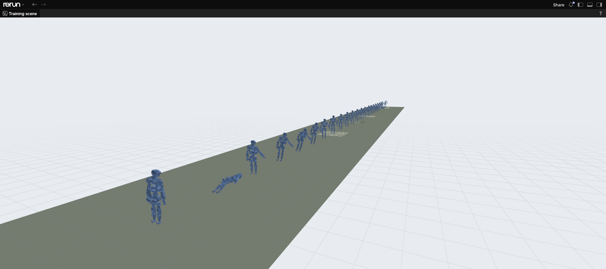
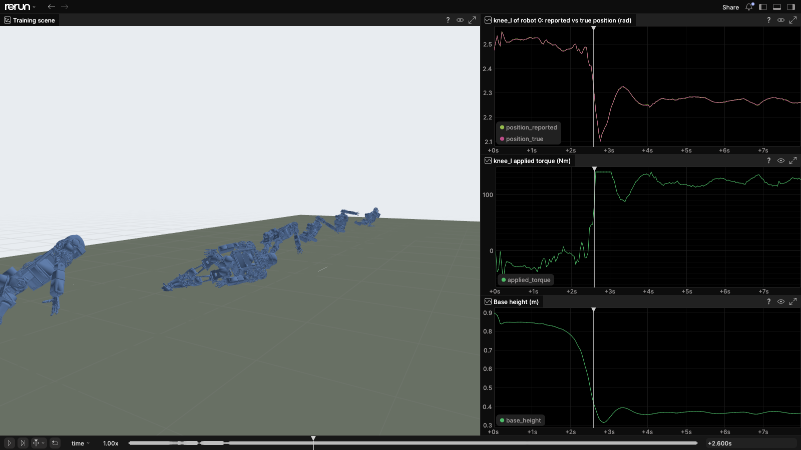
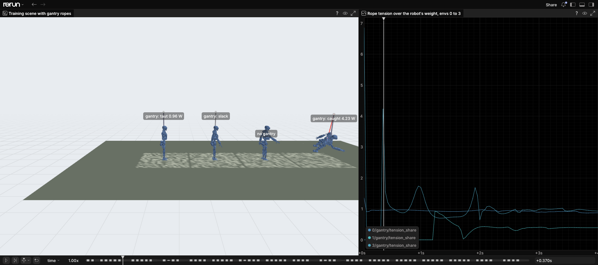

# Seeing the sim

Everything humanoid-sim draws goes to [Rerun](https://rerun.io): the robot in 3D and every signal over time, on one timeline (`time`, in simulated seconds). A recording is either written to an `.rrd` file and opened later, or streamed to a viewer that is already running.

| What you want to see | Tool | Runs where |
|---|---|---|
| A replay of a real capture, sim against the real robot | `humanoid-sim view-replay` | Anywhere with the `newton` and `viz` extras |
| A running real-time session, live | `humanoid-sim view-runtime` | On the machine (or in the container) running `serve` |
| Many robots of a training scene | `SceneRecorder` (`humanoid_sim.signals.scene`) | Inside the training process |
| Named signals of one robot in training | `plant.attach_log(...)`, `plant.log(...)` | Inside the training process |

The images on this page come from real recordings. `docs/images/capture.py` regenerates them; its `SHOTS` list names the command that makes each recording.

## Installing the viewer

```bash
uv sync --extra newton --extra viz     # rerun-sdk, plus Newton for forward kinematics
uv run rerun outputs/replay.rrd        # open a recording
uv run rerun                           # or start an empty viewer that recordings can stream into
```

The viewer must be at least as new as the SDK that wrote the file. Recordings made in the Isaac Lab image (Rerun 0.31) open in a newer local viewer.

## Replays: the sim next to the real robot

`humanoid-sim replay` writes a trace (`trace.npz` and `summary.json`); `view-replay` turns it into a recording:

```bash
humanoid-sim replay ../datasets/humanoid-v1/exc-3a498000fc114f2db2b0655d5d87280c --out outputs/replay
humanoid-sim view-replay outputs/replay/<run> --save outputs/replay.rrd
uv run rerun outputs/replay.rrd
```

The simulated robot is drawn in grey and the real robot, posed from the capture's measured drive positions, as a translucent orange ghost on the same base. Where the two disagree, the ghost separates from the robot.


The plot at the top right shows one drive over two seconds: the demand the real drive received (green), what the real drive measured (orange) and what the simulated drive did (blue). Here the simulated left shoulder follows the demand's timing but with a smaller swing and a lower mean than the real one, which is what the replay's score (`rms_position_rad` in `summary.json`) reports as a 32 mrad error for this drive. The plot below it shows the position residual (sim minus real) of every drive over the whole capture.

The default layout that `view-replay` saves also has a sim-only and a real-only view and one plot tab per drive.



Entity paths, for building your own views:

| Path | Content |
|---|---|
| `/world/sim/<body>`, `/world/real/<body>` | Body transforms of the two robots |
| `/sim/0/drives/<drive>/{position,velocity,torque}` | The simulated drive (drive frame) |
| `/real/drives/<drive>/{position,velocity,torque}` | What the real drive measured |
| `/demand/drives/<drive>/position` | The position demand the drive received |
| `/residual/0/drives/<drive>/position` | Sim minus real |

Drives are named by device (`maxonHEJ70AL1` is the left shoulder flexion); [drives.md](drives.md) lists them. Every replay is recorded under the Rerun application id `humanoid-sim replay` with the capture's name as the recording name, so a layout you arrange and save in the viewer applies to every replay.

## A live runtime session

`view-runtime` opens a running `serve` segment and only reads it. It never writes demands or commands, so it can watch a session that Controls or another client is driving, and it follows a `serve --persist` host from one session to the next if the next one starts within 10 s.

```bash
humanoid-sim serve --segment /tmp/hsim/plant --device cuda:0 &
python examples/runtime_client.py /tmp/hsim/plant --seconds 20 &
humanoid-sim view-runtime /tmp/hsim/plant                       # spawns a viewer
humanoid-sim view-runtime /tmp/hsim/plant --save outputs/runtime.rrd --seconds 20
```

The segment is a file in shared memory, so `view-runtime` has to run on the same machine as `serve`, or in the same container.


Here the client waves both arms (drive positions, top right) and pushes the left forearm 8 s after it attached, which shows as the spike at the left of the applied torques. The session ran in real time on an L4. The robot hangs from the default `suspended` support, so the IMU (bottom right) sees little beyond noise and the slight swing on the cable.

| Path | Content |
|---|---|
| `/world/robot/<body>` | The robot, posed from the truth region |
| `/sim/0/drives/<drive>/{position,velocity,applied_torque,demanded_torque}` | Drive feedback as the client reads it |
| `/sim/0/imu/{gyro,specific_force}/{x,y,z}` | The newest IMU sample of each feedback record |
| `/sim/0/soles/<side>/normal_force` | Ground force on each sole (truth) |
| `/sim/0/base/height` | Base height (truth) |
| `/world/gantry/{rope,anchor,plumb,status}`, `/sim/0/gantry/{tension_n,tension_share,length_m}` | The gantry cable while one hangs, or the label `no gantry`; see [The gantry](#the-gantry) (truth) |
| `/world/gantry/{travel,bridge,trolley}`, `/sim/0/gantry/{position,command}/{x,y,z}` | With a crane (`serve --gantry`): its travel, bridge and trolley, and its actual and commanded position (truth) |
| `/sim/0/host/{late_steps,keeping_up,session}` | Whether the host keeps up with real time; session changes |

Options: `--fps` sets how often the segment is read (30 by default), `--seconds` stops after a while, `--wait` how long to wait for the segment to appear, and `--connect URL` streams into a viewer you started yourself.

## Training scenes

`SceneRecorder` records many environments of an Isaac Lab scene into one recording. It logs the ground (the generated terrain read from the USD stage, shaded by height), any static boxes (at `/world/scene/boxes`, see [world.md](world.md#static-boxes)) or, given the scene with a scan, the room's photo-textured scan and floor (see [world.md](world.md#the-scan-for-viewers)) and each visual mesh of the robot once, then per frame one pose per robot and mesh, which Rerun draws as instances.

```python
from humanoid_sim.signals.scene import SceneRecorder

recorder = SceneRecorder(env, usd, rrd="outputs/scene.rrd", envs=list(range(16)))
for k in range(steps):
    env.step(actions)
    if k % 2 == 0:
        recorder.frame(plant.t_ns)
recorder.close()
```

Each frame copies the poses of the recorded robots from the GPU, so record a few robots at a low rate, for debugging and showcases. Inside a training run that has to stay free of host synchronization, leave it out. `examples/train_scene.py --rrd` is a complete example:

```bash
python examples/train_scene.py --num-envs 6 --seconds 8 --device cuda:0 --rrd outputs/train_scene.rrd
```


The example has no policy. Each robot holds the home pose at the baseline gains and waves its arms, on rough terrain, with randomized friction, base mass and drive latency, and random pushes on the base. A rigid pose does not survive that for long: after 8 s, 1 of 24 robots and 3 of 6 are still standing, and keeping them up is what a task's policy has to learn.



### One robot's signals next to the scene

`plant.attach_log(SignalLog(init=False))` joins the scene's recording, and `plant.log(name, tensor)` logs one value per env at the current time. The example logs the left knee's reported and true position, its applied torque and the base height of robot 0:

```python
from humanoid_sim.signals.log import SignalLog

plant.attach_log(SignalLog(init=False))
plant.log("knee_l/position_reported", plant.measured().drive.position_rad[:, knee], group="drives")
plant.log("knee_l/position_true", plant.truth().drive.position_rad[:, knee], group="drives")
plant.log("base_height", plant.truth().root_pose_w[:, 2], group="base")
```



The reported position is the true one quantized to the knee drive's encoder (4096 counts per revolution, about 1.5 mrad), so the two lines lie on top of each other until you zoom in. Robot 0 stays up for the whole recording: its base settles at about 0.88 m on the terrain, and its knee torque stays within about 10 Nm while the arms wave and the pushes come.

## The gantry

Both views show whether a robot hangs from a gantry rope, and what the rope carries (`humanoid_sim.signals.gantry_view`). `view-runtime` draws it at `/world/gantry`; `SceneRecorder` draws every recorded env's at `/world/gantry/<env>`, finding the gantry through the env's action terms (`plant.gantry`) or from `SceneRecorder(..., gantry=sim.gantry)`.

| Entity (under the env's gantry path) | Content |
|---|---|
| `rope` | A line from the anchor to the harness hook, coloured by the rope's load (below) |
| `anchor` | A marker at the rope's top: the fixed anchor, or a crane's hoist |
| `plumb` | A line straight down from the anchor, as long as the rope's unstretched length, so a rope that leans or is stretched shows against it |
| `status` | The label `gantry: taut 0.88 W` (tension over the robot's weight `W = m g`), `gantry: slack`, `gantry: over-stretched 1.35 W` or `gantry: caught 2.40 W`; `no gantry` for a robot without one, floating above its base |
| `travel`, `bridge`, `trolley` | With a mounted crane: its reach, and its bridge and trolley where they are (the frame's posts are not in a `GantryRig`) |
| `/sim/<env>/gantry/{tension_n,tension_share}` | The rope's tension, in N and as a share of `W` |
| `/sim/<env>/gantry/{length_m,rest_length_m}` | Hook to anchor, and the cable's unstretched length (training scenes only: the runtime's truth does not carry it) |

The colour is the rope's class, from its tension against `W`:

| Class | Colour | When |
|---|---|---|
| slack | grey | Its length is at or below its unstretched length, so it pulls nothing |
| taut | green | It carries up to `OVERLOAD_FACTOR` (1.5) times the full weight. The full weight is the stretch `W / k` of a cable that just holds the robot (`support.full_weight_stretch_m`, 2 cm, for the harness cable), where a hung robot sits while swings and pushes move it around |
| over-stretched | red | It carries more than 1.5 weights, or is stretched beyond 1.5 times `W / k` |
| caught | red | The tension is over `CAUGHT_SHARE` (3) times the weight, as when a rope stops a falling robot |

A rope hung from the wrong anchor, such as one built over a robot's default spawn point when the robot starts elsewhere, shows at once: it leans away from its plumb line and is red.

A training task can add its own words to the label: `recorder.notes[env] = "phase: stand"` makes it `gantry: taut 0.88 W | phase: stand`. The recorder never imports task code, so the task sets the string whenever its operator changes phase or the episode ends.

`examples/train_scene.py --gantry` hangs the robots by env index modulo 4 with a rope at 80% of the weight, a slack rope, no rope and a rope whose anchor is 1.0 m off to the side:



The labels and lines come from the last physics step, at the recorder's own rate. With no recorder, nothing is drawn or computed.

## Regenerating the images

```bash
uv run python docs/images/capture.py              # every shot whose recording is in outputs/shots/
uv run python docs/images/capture.py replay        # shots whose names start with "replay"
uv run python docs/images/capture.py scene-hero --at 2.5 --out /tmp/hero.png
```

The script starts a headless viewer, opens the recording, sends the shot's layout and camera as a blueprint, moves the timeline and saves a screenshot. The training scene recordings need a GPU; `sky/e2e.sky.yaml` writes them on a SkyPilot node.
