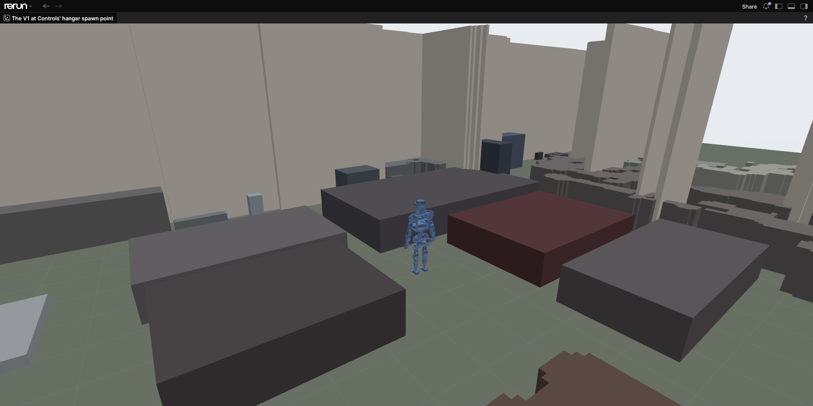
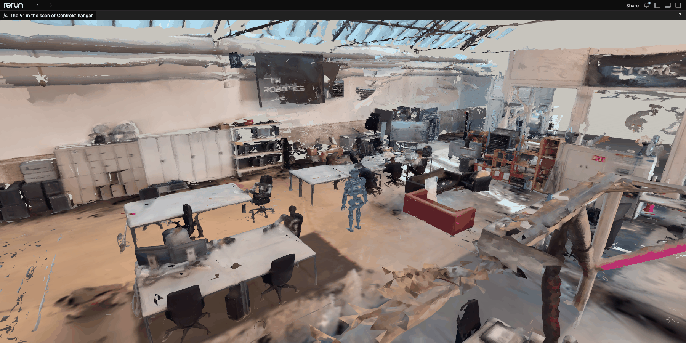

# The world around the robot

Around the robot, humanoid-sim has a ground (a flat plane, or in training a heightfield terrain, a surface given as a grid of heights), optional static boxes standing on it (a room's walls and furniture, such as Controls' hangar), an optional [support](glossary.md#support) that holds the robot up, and external [disturbances](glossary.md#disturbance). The code is in `src/humanoid_sim/world/` and in the scene builders that use it: `robot_scene_cfg` for training (`src/humanoid_sim/train/scene.py`) and `SimCore` (`src/humanoid_sim/sim.py`) for replays and the real-time runtime.

| Feature | Training | Replay | Runtime (`serve`) |
|---|---|---|---|
| Flat ground | default; friction set by `ground_friction` | profile friction | profile friction |
| Heightfield terrain | `robot_scene_cfg(..., terrain=...)` | none | none |
| Static boxes (walls, furniture) | `robot_scene_cfg(..., scene=...)` | none | `--scene` and `--spawn` |
| Start pose | `robot_scene_cfg(..., pose=...)`: `"home"` (default) or `"standing"` | the capture's first measured drive positions | the profile's `poses.start` (V1 `standing`, G1 `home`) or `--pose`; `RESET` can pick either |
| Free base | always | none | `--support free` |
| Fixed base | none | `--base fixed` | `--support suspended` (default) |
| Base orientation prescribed through base joints | none | `--base yaw` (default) or `--base orientation` | none |
| Gantry rope | a `Gantry` your action term applies | none | `SET_SUPPORT` command in a free session |
| Force pushes on a body | `ForcePush` | none | `APPLY_DISTURBANCE` body wrench |
| Torque on a joint | `plant.core.external_torque` | none | `APPLY_DISTURBANCE` joint torque |

## Ground

The flat ground is a plane at z = 0 from `ground_cfg` (`src/humanoid_sim/physics/isaaclab.py`), with restitution 0 and the same static and dynamic friction. Its friction defaults to the profile's `model.ground_friction`, 1.0, which matches the floor of Controls' MuJoCo scene (`urdf/scene.xml`: friction 1, condim 3). Training can override it with `robot_scene_cfg(..., ground_friction=...)`; replays and the runtime always use the profile's value.

MJWarp gives a contact the larger friction coefficient of its two shapes. The ground and the robot both have one, and the higher wins. Training randomizes friction on the robot side (the `friction` parameter in [training.md](training.md#randomization) writes every robot shape), which only has an effect when the ground or terrain friction is 0. With ground friction 0 and no friction randomization, the robot shapes' own friction from the asset decides.

The robot touches the world through one convex hull per body and a thin box under each sole; the collision model is described in [robot-model.md](robot-model.md).

## Heightfield terrain

The robot's contacts run in MJWarp's own collision pipeline, which collides the robot's hulls and boxes with heightfields but not with triangle-mesh terrain. Isaac Lab's terrain generator builds the whole terrain as one triangle mesh and tags it for conversion to a heightfield only when every sub-terrain sets `convert_to_heightfield`, which the `Hf*` configs do by default; Newton then replaces the mesh by a heightfield at the terrain's horizontal resolution. `heightfield_terrain_cfg` (`src/humanoid_sim/world/terrain.py`) enforces this and raises a `ValueError` for any sub-terrain that is not an `Hf*` config with conversion on. Mesh sub-terrains (Isaac Lab's `Mesh*` configs, such as stairs with vertical risers) are therefore not supported.

This module is the mechanism only. Which tiles a task trains on, how many, how hard, and any curriculum over them are the task's choice and live in humanoid-learning with its terrain generators; humanoid-sim fixes only what the physics can collide with. So `heightfield_terrain_cfg` has no stock tile mix and no default layout: the caller states the grid.

`heightfield_terrain_cfg(sub_terrains, *, size_m, rows, cols, border_m, curriculum, ...)` takes a dict of `Hf*` sub-terrain configs, whose `proportion` fields act as weights, and returns an Isaac Lab `TerrainImporterCfg`:

| Option | Default | Meaning |
|---|---|---|
| `size_m` | required | Side of one square tile (m) |
| `rows`, `cols` | required | Tile grid; with `curriculum`, rows are difficulty levels |
| `border_m` | required | Border around the grid (m) |
| `curriculum` | required | Difficulty grows with the row; without it each tile draws a random difficulty |
| `friction` | 1.0 | Static and dynamic friction of the terrain; 0 when robot friction is randomized |
| `horizontal_scale_m`, `vertical_scale_m` | 0.1, 0.005 | Heightfield grid spacing and height step (m) |
| `seed` | `None` | Seed of the terrain generator |

How envs land on tiles:

- With `curriculum`, each column holds one tile type, assigned by the `proportion` weights, and each row is a difficulty level: row `r` of `rows` draws its difficulty uniformly from `[r / rows, (r + 1) / rows)`. Without it, every tile draws its type by the weights and its difficulty uniformly from [0, 1].
- The importer is created with `max_init_terrain_level=0`, so every env starts on the first row. Envs are split over the columns in index order, `num_envs / cols` to a column.
- Every env on a tile has its origin at that tile's origin, so envs that share a tile spawn on the same spot. Robots in different envs never touch each other (each env is its own world in the solver), so sharing a tile only changes what a recording shows and how many different tiles the envs see. `examples/train_scene.py` gives each robot its own tile with `rows=1, cols=num_envs, size_m=2.5, curriculum=False`.
- The origin's height is the highest point of the heightfield within 1 m of the tile centre. The robot's default state puts it upright in its initial pose with its lowest sole corner 1 mm above that height ([training.md](training.md#the-initial-pose)), so on rough tiles the feet start above the surface and drop by at most the local height variation.

Moving envs between rows is Isaac Lab's terrain curriculum (`TerrainImporter.update_env_origins`), driven from your task.

```python
from isaaclab.terrains.height_field import HfPyramidSlopedTerrainCfg, HfWaveTerrainCfg

from humanoid_sim.train.scene import robot_scene_cfg
from humanoid_sim.world.terrain import heightfield_terrain_cfg

# Slopes and waves on a 10 by 20 grid of 8 m tiles, rows as difficulty levels, the terrain at zero friction
# because the robot's friction is randomized:
terrain = heightfield_terrain_cfg({
    "slopes": HfPyramidSlopedTerrainCfg(proportion=0.5, slope_range=(0.0, 0.1), platform_width=2.0),
    "waves": HfWaveTerrainCfg(proportion=0.5, amplitude_range=(0.0, 0.03), num_waves=4),
}, size_m=8.0, rows=10, cols=20, border_m=20.0, curriculum=True, friction=0.0)
cfg.scene = robot_scene_cfg(4096, usd, terrain=terrain)
```

`cfg` and `usd` are the env config and robot USD from [training.md](training.md#a-minimal-environment). When a terrain is given, the scene has no flat ground and `ground_friction` is ignored.

### The heightfield's base

MuJoCo collides a shape with a heightfield cell by cell, each cell a prism from the surface down to the heightfield's base, and pushes a shape that has sunk into a prism out the nearest way. Newton exports a heightfield to MuJoCo with a base 0.1 mm below its lowest point, so over the lowest cells a prism is thinner than a landing foot sinks into it (soft contact), and the foot is pushed out downwards, through the terrain. The G1's feet, four 5 mm spheres each, fell 1 to 2 cm into a bumpy tile on landing and kept falling; the V1's sole plates sank about 3 cm.

`apply_heightfield_base` (`src/humanoid_sim/physics/isaaclab.py`, called by `RobotPlant`) therefore deepens every heightfield's base in the running MJWarp model to the profile's `physics.mjwarp.heightfield_base_m` (1.0 m), together with the heightfield's bounding box and radius. The surface is unchanged, and nothing lies under the terrain for the deeper base to touch. `tests/test_world.py::test_heightfield_terrain_carries_the_feet` drops each robot onto a bumpy tile and checks that its soles settle on top, within a few millimetres of soft contact. Kamino collides heightfields in Newton's own pipeline and is not affected.

### Heightfield collision overflow

When a fallen robot lies on a heightfield, MJWarp prints this, often many times in one step (four robots down in `examples/train_scene.py` print it thousands of times per simulated second):

```text
height field collision overflow, number of collisions >= 50 - please adjust resolution:
 decrease the number of hfield rows/cols or modify size of colliding geom
```

MJWarp tests each robot shape against the heightfield cells under it, collects up to 50 candidate contacts per shape and heightfield pair (MuJoCo's `mjMAXCONPAIR`) and keeps up to four of them. A large hull lying flat across many cells finds more than 50 candidates. The cells after the 50th are skipped for that pair in that step, so the part of the shape over them can sink into the terrain until the shape covers fewer cells. For a fallen robot that the task is about to reset this is harmless. A sole box (0.25 by 0.09 m) covers too few cells to reach the cap at the default grid, so robots standing on their soles do not cause the message. It is one reason to keep the heightfield grid coarse (`horizontal_scale_m`, 0.1 m by default): a finer grid puts more cells under every body. A task that needs a lying robot's contacts, such as getting up, needs a grid coarse enough that a lying torso stays under the cap.

The message is separate from MJWarp's `nconmax` and `njmax` overflow warnings, which mean the contact or constraint buffers of the step ran out (`physics` block of `profiles/ethrc_v1.yaml`).

## Static boxes

A room enters the scene as static boxes fitted to its walls and furniture. They stand on the flat ground, which stays the walking surface. The physics cannot collide the robot with a scan's triangle mesh (see [Heightfield terrain](#heightfield-terrain)), but it collides boxes like any convex shape. The code is in `src/humanoid_sim/world/boxes.py`.

Controls' hangar is such a room. Its MuJoCo simulation stands the robot among 470 boxes fitted to a scan of the ETHRC hangar: 82 wall slabs and one or a few blocks per piece of furniture, all turned by the same 1.75° about the vertical. The boxes are in Controls' `ros2_ws/src/sim/ethrc_sim/environments/hangar/hangar_proxy.npz` (a git-lfs file: run `git lfs pull` in the Controls checkout), and its spawn point, `HANGAR_SPAWN` in `ethrc_sim/environments.py`, is (-4.42, 3.48) m, open floor 1.35 m from the nearest box. humanoid-sim does not copy the file: you pass its path.

### The file

An `.npz` in metres and radians, z up, with the floor at z = 0:

| Array | Shape | Meaning |
|---|---|---|
| `center` | `[N, 3]` | Box centres in the file's frame |
| `half` | `[N, 3]` | Half extents along the box's own axes |
| `yaw` | scalar or `[N]` | Rotation of each box about the vertical through its centre: one value for every box, or one per box |
| `rgb` | `[N, 3]`, optional | Colour in [0, 1], for drawing |
| `wall` | `[N]` bool, optional | Which boxes are walls; they are drawn light grey |

Other arrays are ignored, such as Controls' `floor_corners`, the outline of its scan's floor. `StaticBoxes.load(path, spawn_m)` reads a file and refuses a git-lfs pointer, a box without a positive half extent in every axis, mismatched shapes or non-finite values.

### Placement

`spawn_m` is the point of the file's frame, (x, y) in metres, that goes to the world origin, where the robot starts. Every box is moved by `-spawn_m` and keeps its yaw about its own centre. This is how Controls' MuJoCo scene places the hangar (`add_environment` in `ethrc_sim/environments.py` at 44353e2b), so with the same spawn point a box is at the same world coordinates in both simulators. `tests/test_static_boxes.py` checks this corner by corner, against MuJoCo's own kinematics on boxes added as Controls adds them, both for the file as loaded and for the shapes the solver ends up with.

The truth (base pose, body poses) is in the world frame. A point of the file's frame is the world point plus `spawn_m`, which is how a client maps the truth onto a map drawn in the file's frame.

### In a scene

The boxes become USD `Cube` prims with the physics collision API, under `/World/StaticBoxes`, each with the ground's friction and no restitution, and with the box's colour as its display colour. They are outside the environment namespace, so the solver has one set of static shapes that every environment's world collides with at the same world coordinates. For that reason a scene with boxes starts every environment's robot at the world origin: each environment is its own solver world, so robots at one spot never touch each other.

| Front end | How |
|---|---|
| Training | `robot_scene_cfg(n, usd, scene=StaticBoxes.load(path, spawn_m))`. `env_spacing` becomes 0 and may not be set to anything else, and a `terrain` is refused: the boxes stand on the flat ground. Pass `ground_friction=0` as usual when friction is randomized on the robot; the boxes take the same value. |
| `SimCore` | `SimCore(usd, ..., scene=StaticBoxes.load(path, spawn_m))` |
| Runtime | `humanoid-sim serve ... --scene PATH --spawn X Y`. A spawn point inside a box is refused. The descriptor's `scene` names the file, its SHA-256, the number of boxes, the spawn point and the spawn's clearance (see [runtime.md](runtime.md#descriptor)). |
| Benchmarks | `humanoid-sim bench ... --scene PATH --spawn X Y`, for each workload |

A robot standing at the spawn point of the hangar:

```bash
python examples/scene_stand.py --scene <controls>/ros2_ws/src/sim/ethrc_sim/environments/hangar/hangar_proxy.npz \
  --spawn -4.42 3.48 --seconds 10 --device cuda:0 --rrd outputs/hangar_v1.rrd
```



`SceneRecorder` draws the boxes as one mesh at `/world/scene/boxes` and sizes the ground square to reach 2 m beyond them. `view-runtime` draws a host's boxes too, when the descriptor's file is readable where the viewer runs and has the same digest. For a scanned room, the viewers can draw the scan instead (next section).

### The scan, for viewers

A scanned room can come with its look: the photo-textured mesh of the scan and a flat textured floor. They are drawn in Rerun, never collided: the robot collides with the boxes. The code is in `src/humanoid_sim/world/scan.py`.

Controls' hangar has these next to its boxes, in the same folder and also in git-lfs: `hangar_visual.obj` (832k triangles, every corner with its own texture coordinate, the scan's own floor cut out), its texture `hangar_visual.png` (7740 by 7740 pixels, the light baked in) and `hangar_floor.png`, the floor seen from above. As with the boxes, humanoid-sim does not copy them: `ScanFiles.of(mesh, texture, floor_texture)` names them and records their SHA-256 digests, and `StaticBoxes.load(path, spawn_m, scan=...)` attaches them to the scene.

They are drawn as Controls' MuJoCo `hangar_scan` environment draws them (`ethrc_sim/environments.py` at 44353e2b):

- The mesh moves by `-spawn_m`, like the boxes, without rotation or scale.
- Its texture sits on it as MuJoCo puts it: MuJoCo flips an OBJ's v coordinate (the OBJ's origin is the image's bottom left) and keeps the image's first row at v = 0, so each corner shows the texel at (u, 1 - v) from the image's top left, which is how Rerun reads a texture coordinate.
- The floor is a quad over the boxes file's `floor_corners`, 1 mm above the ground the boxes stand on, its texture's corners (0, 0), (1, 0), (1, 1) and (0, 1) on the four corners in order.
- The ground plane is not drawn, the sky is a neutral grey, and the scan is not lit: its texture holds the light. Controls gives every OBJ normal +z and tints the texture to 70 % for MuJoCo's lights to the same end; Rerun draws a mesh without normals unlit, so neither is needed.

`tests/test_scan.py` builds a scan and its floor into a MuJoCo world as Controls does and checks every face corner's position and the texel it shows against what humanoid-sim logs.



The scan comes at two levels of detail:

| Detail | Scan | Floor texture | Hangar, in a recording | For |
|---|---|---|---|---|
| `full` | every triangle with its texture coordinates, and the whole texture | 1691 by 1065 | 150 MB | recordings to a file |
| `live` | vertices merged on a 0.15 m grid (93k vertices, 164k triangles), each coloured with the texture averaged over the face corners merged into it | at most 512 across | 3 MB | viewers that stream |

The texture packs every triangle on its own patch, so a decimated mesh cannot keep texture coordinates; the live detail carries the texture as vertex colours instead. Building either takes about 3 s, most of it reading the OBJ. The boxes alone add about 0.1 MB.

| Where | How |
|---|---|
| `SceneRecorder(env, usd, ..., scene=boxes)` | Draws the scene's scan with its floor in place of the ground (`draw="boxes"` keeps the boxes), at `detail` (`full` into a file, `live` when streaming, unless given), and gives the recording a default layout against the neutral sky. Entities `/world/scene/scan` and `/world/scene/floor`. |
| `serve --scene ... --scan-mesh OBJ --scan-texture PNG --scan-floor-texture PNG` | The descriptor names the files and their digests, for viewers |
| `view-runtime --draw scan\|boxes --detail full\|live` | Draws the host's scan when its files are readable here with the same digests |
| `examples/scene_stand.py --scan-mesh ... --draw ... --detail ...` | A robot standing in the scan |

```bash
H=<controls>/ros2_ws/src/sim/ethrc_sim/environments/hangar
python examples/scene_stand.py --scene $H/hangar_proxy.npz --spawn -4.42 3.48 --scan-mesh $H/hangar_visual.obj \
  --scan-texture $H/hangar_visual.png --scan-floor-texture $H/hangar_floor.png --seconds 6 --device cuda:0 \
  --rrd outputs/hangar_v1_scan.rrd
```

### What the boxes cost

Measured on one L40S with the hangar's 470 boxes and every robot at the spawn point, holding the home pose at the baseline gains:

- Contacts. A robot clear of the boxes has none with them: a standing V1 had 16 contacts per world and a G1 lying on the floor 8, with and without the hangar, and no step overflowed `nconmax` or `njmax`. A robot that leans on or lies across boxes adds its contacts with them to the same pool (`nconmax` in the profile's `physics` block, an average per world shared by all worlds).
- Broadphase. MJWarp's all-pairs broadphase tests every robot shape against every box in every world: per world, the V1's 290 candidate pairs become 12,040 and the G1's 36 become 16,956.
- Physics time per step (the scene write, the solver step with collision detection, the scene update):

| Robots | Without boxes | With the hangar |
|---|---|---|
| 1 V1 | 0.43 ms | 0.43 ms |
| 4,096 V1 | 1.49 ms | 1.86 ms |
| 16,384 V1 | 5.58 ms | 7.01 ms |
| 4,096 G1, lying on the floor | 1.90 ms | 2.69 ms |

- The runtime host (`humanoid-sim bench --runtime`, one free V1): 1.37 ms per step without boxes and 1.36 ms with the hangar, 2.9 times faster than real time either way.

The hangar costs nothing in the runtime, and in training about a quarter more physics time per step for the V1 (two fifths for the G1, which has more shapes). With the plant's work around the physics, the whole step of 16,384 V1s grows from 7.5 to 8.9 ms.

## Supports

A support holds the robot up while it is tested, the way the real robot hangs in its gantry. Which ones a front end offers is in the table at the top of this page.

### Free

No support: the robot stands or falls on the ground. Training scenes are free (`robot_scene_cfg` has no fixed-base option). A training robot spawns upright in the pose that `robot_scene_cfg`'s `pose` names; held rigidly, the V1's default home pose stands still on flat ground and its standing pose tips over within a second, and the G1 tips over from its home pose too, its ankles too soft at Unitree's deploy gains ([training.md](training.md#the-initial-pose)). In the runtime, `--support free` starts the robot standing on the ground; until a client attaches, the host holds it in its start pose, base included ([runtime.md](runtime.md)).

### Suspended (fixed base)

The articulation's root is fixed to the world (`fix_root_link` in `articulation_cfg`), as in Controls' suspended profile. The runtime starts this way by default (`--support suspended`), with the base 0.3 m above its standing height so the feet hang clear of the ground. Replays use it with `--base fixed`.

The choice is made when the scene is built and cannot change in a session: a suspended runtime session cannot release its base, and a free one cannot be suspended. Writing the base pose back every step would not suspend the robot either: the whole robot falls freely within each step, so the joints never carry its weight (`src/humanoid_sim/world/supports.py`).

### Base joints (replays)

Replays of captures taken on the gantry can move the base with the capture's IMU. They use an asset built with `humanoid-sim build-asset --base-joints`, which adds yaw, pitch and roll joints above the base; the root is fixed to the world and the three joints follow position and velocity targets through a stiff PD (1e5 Nm/rad, 2e3 Nm s/rad, `BASE_JOINT_STIFFNESS` and `BASE_JOINT_DAMPING` in `src/humanoid_sim/physics/isaaclab.py`). `--base yaw` (the default) follows only the yaw, `--base orientation` the full orientation. See [replay-and-sysid.md](replay-and-sysid.md).

### Gantry rope

`Gantry` (`src/humanoid_sim/world/supports.py`) mirrors Controls' test gantry (`ethrc_sim/support.py`), batched over envs. Each env has one rope or none, attached to the base (the articulation root unless `body` is given). A rope is one of two kinds.

A tension program (`hang_tension`) pulls straight up with a force that is piecewise linear in time between breakpoints `(s, N)` and held beyond both ends. The force is split evenly over points fixed in the base frame, up to `max_points` (2 by default). They are given as `attachment_b` (base-frame coordinates, m) or as `attachment_bodies`, whose positions at hang time are fixed in the base frame from then on (for example both shoulders, `shoulder_connector_l_1` and `shoulder_connector_r_1`).

A slack cable (`hang_cable`) runs from one base-frame harness point to a world anchor `overhead_m` above where that point was when the cable was hung. Its unstretched length is a program of breakpoints `(s, m)`, so lengthening it lowers the robot. The cable pulls along its line only when stretched: `T = max(0, k * extension + c * extension_rate)` with `k = stiffness_n_m` and `c = damping_n_s_m`; while slack it pulls nothing.

| Call | Arguments | Effect |
|---|---|---|
| `hang_tension(env_ids, t_ns, breakpoints_s_n, *, attachment_b=None, attachment_bodies=None)` | 1 to 8 breakpoints, tension ≥ 0 | Vertical tension program from `t_ns` |
| `hang_cable(env_ids, t_ns, *, attachment_b, overhead_m, length_breakpoints_s_m, stiffness_n_m, damping_n_s_m)` | 1 to 8 breakpoints, lengths > 0 | Slack cable from `t_ns` |
| `release(env_ids)` | `[n]` env ids | No rope for these envs |
| `apply(t_ns)` | step start, plant time | Adds this step's rope forces |
| `tension_n`, `distance_m` | `[E]` | Total rope force on the last step; cable length from harness point to anchor |

Program times are relative to the hang time and must be non-negative and increasing. The forces go through the articulation's instantaneous wrench composer, which Isaac Lab clears after every write to the simulation, so `apply` has to run before every physics step; it adds to any other forces on the base. `SimCore` calls it in every step, so the runtime and any script built on `SimCore` only hang and release ropes. The `replay` command never hangs one.

In the runtime, a free session hangs a rope with the `SET_SUPPORT` mailbox command (`{"support": "gantry", ...}` with a tension program or a cable) and drops it with `{"support": "free"}`; the truth region reports the rope tension. The argument names are in [runtime.md](runtime.md).

In training nothing calls `apply` for you. A rope works when the action term applies it before the plant's step, while `plant.t_ns` is still the step start:

```python
import torch

from humanoid_sim.world.supports import Gantry


class HungPoseOffsets(PoseOffsets):  # PoseOffsets from training.md, "A minimal environment"
    def __init__(self, cfg, env):
        super().__init__(cfg, env)
        self.gantry = Gantry(self._asset)
        self.weight_n = float(self._asset.data.body_mass.torch[0].sum()) * 9.81  # once, at startup

    def apply_actions(self):
        self.gantry.apply(self.plant.t_ns)
        super().apply_actions()

    def reset(self, env_ids=None):
        super().reset(env_ids)
        if env_ids is None or isinstance(env_ids, slice):
            env_ids = torch.arange(self.num_envs, device=self.device)
        env_ids = torch.as_tensor(env_ids, device=self.device, dtype=torch.long)
        # Carry the full weight for 1 s, then lower the tension to zero over 3 s.
        self.gantry.hang_tension(env_ids, self.plant.t_ns, [(0.0, self.weight_n), (1.0, self.weight_n), (4.0, 0.0)],
                                 attachment_b=[0.0, 0.0, 0.3])
```

The tests exercise the gantry through `SimCore` (`tests/test_supports.py`): a tension equal to the robot's weight holds its centre of mass in place, and a cable settles at its unstretched length plus weight over stiffness.

### Prescribed pose (runtime)

The runtime's `PRESCRIBE_POSE` command holds a given joint pose, and the base pose in a free session, by writing the state before every step until released. It holds the robot kinematically while a test is set up and models no physical support; see [runtime.md](runtime.md).

## Disturbances

### Force pushes in training

`ForcePush` (`src/humanoid_sim/world/disturbances.py`) pushes one body horizontally in the world frame, in a random heading. Each push has a magnitude drawn uniformly from `magnitude_n` and lasts a duration drawn from `duration_s`; the next push starts `interval_s` (also uniform) after the previous one ends. `level` scales the magnitude, as a float or a per-env `[E]` tensor, for curricula. The force goes through the articulation's permanent wrench composer, so it stays applied between calls; everything runs on the device without host syncs.

| Call | Meaning |
|---|---|
| `ForcePush(robot, body, *, interval_s, duration_s, magnitude_n, level=1.0, seed=0)` | Ranges are `(low, high)` in s and N |
| `reset(env_ids, t_ns)` | No force for these envs; their first push starts `interval_s` after `t_ns` |
| `step(t_ns)` | Start and end pushes due by `t_ns` and write the forces; once per physics step or once per policy step |
| `force` | `[E, 3]` current push force (N, world frame) |

A training env steps it from its action term. Calling `step` in `apply_actions` times pushes to the 4 ms physics step; calling it in `process_actions` times them to the policy step.

```python
import torch

from humanoid_sim.world.disturbances import ForcePush


class PushedPoseOffsets(PoseOffsets):  # PoseOffsets from training.md, "A minimal environment"
    def __init__(self, cfg, env):
        super().__init__(cfg, env)
        self.push = ForcePush(self._asset, "Component171_1", interval_s=(2.0, 5.0), duration_s=(0.1, 0.2),
                              magnitude_n=(50.0, 150.0), seed=1)
        self.push.reset(torch.arange(self.num_envs, device=self.device), self.plant.t_ns)

    def apply_actions(self):
        self.push.step(self.plant.t_ns)
        super().apply_actions()

    def reset(self, env_ids=None):
        super().reset(env_ids)
        if env_ids is None or isinstance(env_ids, slice):
            env_ids = torch.arange(self.num_envs, device=self.device)
        self.push.reset(torch.as_tensor(env_ids, device=self.device, dtype=torch.long), self.plant.t_ns)
```

`Component171_1` is the upper body, the body above the waist yaw joint. Body names are the merged URDF link names described in [robot-model.md](robot-model.md). They come from the CAD export and can mislead: the right foot is `bottom_universal_joint_l_1` (it hangs from `foot_roll_r`).

### Joint torques in training

`plant.core.external_torque` is an `[E, 22]` tensor of joint torques (Nm, description joint order) that the plant adds to the drives' joint torques in every step (`PlantCore.pre_physics` in `src/humanoid_sim/core.py`). It acts outside the drives: their feedback does not include it. Write it in place; `plant.reset` zeroes it for the envs it resets.

### Disturbances in the runtime

A Controls test applies disturbances to the running robot with the `APPLY_DISTURBANCE` mailbox command ([runtime.md](runtime.md) has the mailbox):

- A body wrench, `{"body": name, "force_n": [x, y, z], "torque_nm": [x, y, z], "duration_s": s}`, in the world frame, applied through the instantaneous wrench composer in every step until it expires. Several can overlap.
- A joint torque, `{"joint": name}` or `{"drive": name}` for the joint of a 1:1 drive, with `"torque_nm"`, an optional `"frequency_hz"` (0 for a constant torque, otherwise a sine) and `"duration_s"` (null: until cleared). It goes through the plant's external joint torque (`PlantCore.external_torque`), outside the drive's feedback. A `torque_nm` of 0 clears it.

A `RESET` command clears all active disturbances. Faults (`INJECT_FAULT`: encoder freeze, IMU bias or spike, power sag) act on the devices and are covered in [runtime.md](runtime.md).

## What is not modeled

- A room collides as boxes only. Its scan is drawn as a textured mesh but never collided, the Gaussian splat of the hangar is not drawn, and there are no other static shapes (cylinders, meshes).
- Static boxes stand on the flat ground; they cannot be combined with a heightfield terrain, and every environment of a scene with boxes starts at the spawn point.
- There is no triangle-mesh terrain (stairs with vertical risers, mesh obstacles), for the collision reason above.
- Replays and the runtime have no terrain; they always use the flat ground at the profile's friction.
- The training scene has no fixed-base or base-joint option; supports in training are limited to a `Gantry` your task applies.
